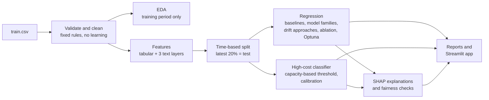
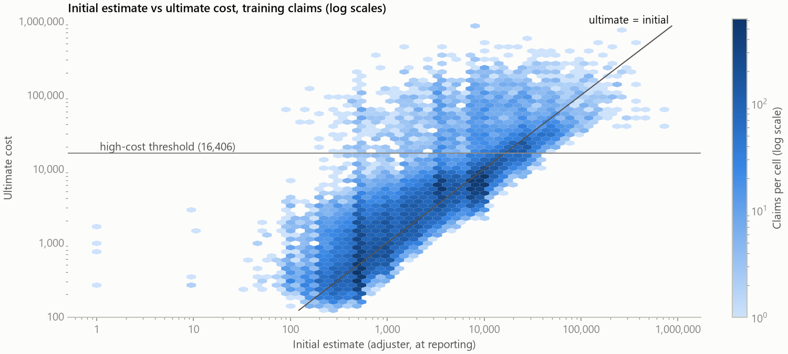
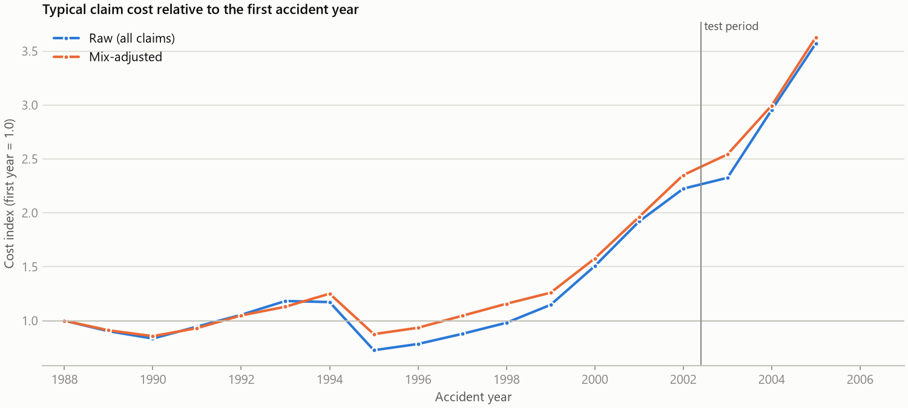
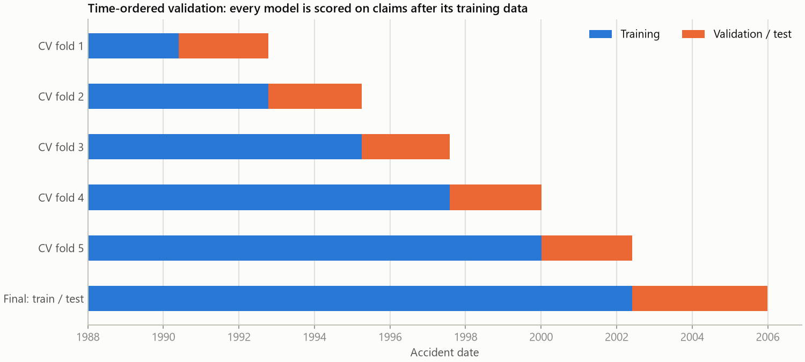
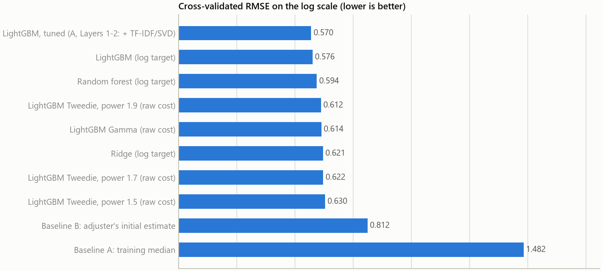
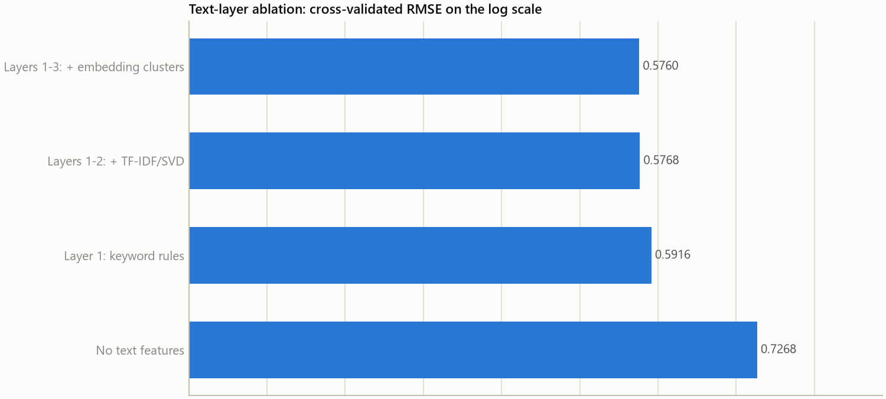
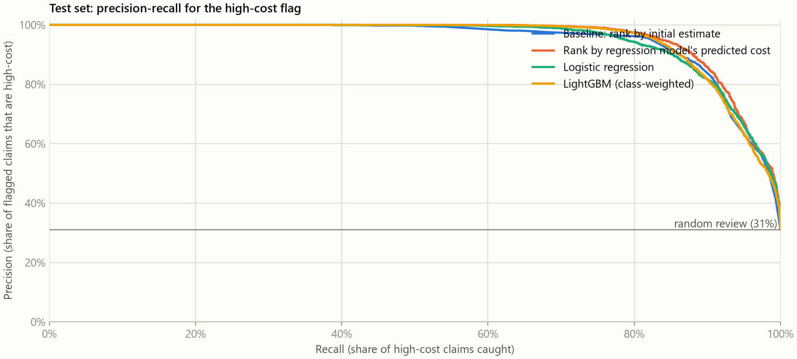
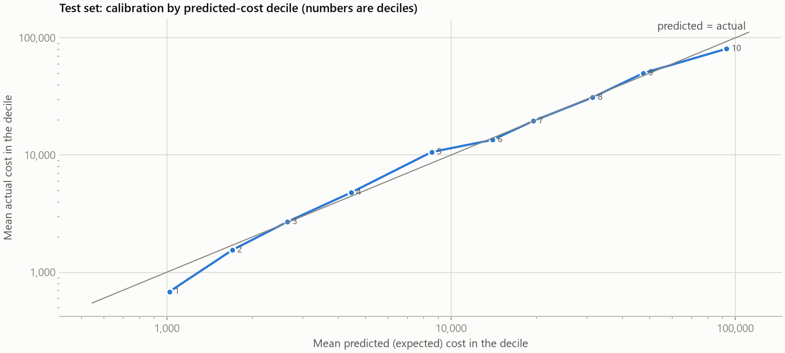
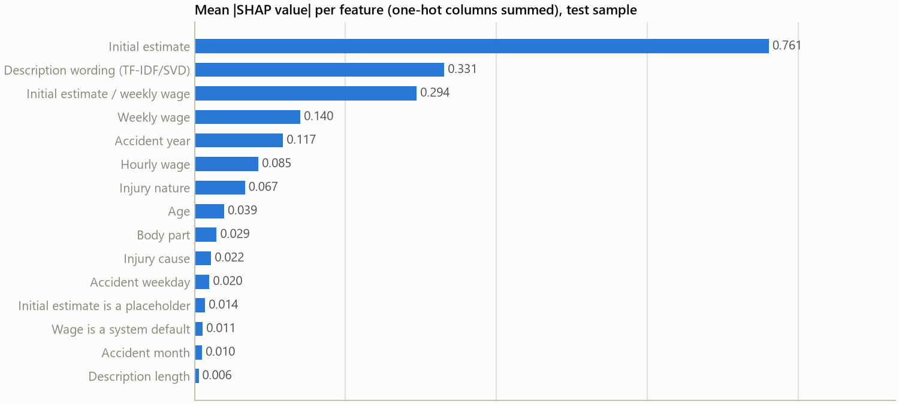

# Workers' Compensation Claim Cost Prediction

Predict the **ultimate cost** of a workers' compensation claim at the moment it is reported,
**flag likely high-cost claims** for early escalation, and **explain the drivers** of every
prediction, using only information available at reporting time.

## Business problem

When a workplace-injury claim is opened, an adjuster records an initial cost estimate. The
final (ultimate) cost is only known months or years later. Poor early estimates cause
under-reserving, mispriced premiums and late escalation of severe claims. This project builds
decision support for that first moment:

| Output | Question it answers | Main users |
|---|---|---|
| Expected ultimate cost, with an 80% range | How much should we reserve for this claim? | Claims adjusters, finance / actuarial (reserving) |
| High-cost flag (top 10% of cost) | Should a senior adjuster or nurse case manager look at this claim now? | Claims adjusters, team leads |
| Drivers of each prediction | Why is this claim expected to be expensive? What drives cost across the book? | Adjusters, underwriting (pricing), risk & safety |

## Data

- Kaggle **[Actuarial Loss Estimation](https://www.kaggle.com/competitions/actuarial-loss-estimation)**,
  file `train.csv`. Download it from the competition's data page
  (a Kaggle account is needed) and save it as `data/raw/train.csv`. The file is gitignored and
  not redistributed here.
- **Synthetic data.** The claims are realistic but generated, so relationships in this data
  (for example, the relative costs of injury types) may not hold for real claims. The
  methodology, not the fitted coefficients, is what transfers.
- Fields: accident and report dates, claimant age, gender, marital status, dependants, weekly
  wage, part-time / full-time status, hours and days worked, a free-text claim description, the
  adjuster's initial estimate, and the target `UltimateIncurredClaimCost`.

## Approach



1. **Data quality** ([report](reports/data_quality_report.md)): every issue gets a documented
   rule (invalid hours, placeholder wages, encoding errors). Bad values become missing and are
   imputed later, inside the model pipeline, from training rows only.
2. **EDA** ([report](reports/eda.md)): how rough adjusters' first estimates are; which injuries
   are frequent vs expensive; and a key finding for everything that follows: costs rise steeply
   over time, as a price-level change, not a change in claim mix.
3. **Features** ([report](reports/features.md)): tabular features (reporting delay, wages,
   flags for recording artifacts) plus three layers of NLP on the claim description: a keyword
   taxonomy (body part, nature, cause), TF-IDF with truncated SVD, and sentence-embedding
   (all-MiniLM-L6-v2) clusters, all inside one scikit-learn pipeline.
4. **Validation**: a time-based test set (the most recent 20% of claims), scored once, and
   time-ordered cross-validation inside the training period for every decision.
5. **Regression** ([results](reports/results.md)): baselines (training median, adjuster's
   estimate), Ridge, random forest and LightGBM on log cost, Tweedie and Gamma losses, four ways
   of handling price drift, a text-layer ablation, Optuna tuning, smearing for the
   retransformation bias, 80% intervals from quantile models, and error analysis.
6. **High-cost flag**: baseline ranking by initial estimate vs logistic regression and
   class-weighted LightGBM, a threshold set from review capacity, and probability calibration.
7. **Explainability and fairness** ([report](reports/explainability.md)): SHAP global and
   per-claim explanations, plain-English insights, error and flag rates by gender and age band,
   and the model with vs without gender.

## Results

<!-- BEGIN GENERATED: results -->

| Model (test set, most recent 20% of claims)                 | RMSLE   | R² (log)   | MAE (typical prediction)   | Total predicted / actual   |
|:------------------------------------------------------------|:--------|:-----------|:---------------------------|:---------------------------|
| Final model (LightGBM, tuned (A, Layers 1-2: + TF-IDF/SVD)) | 0.549   | 0.876      | 10,353                     | 1.04                       |
| Adjuster's initial estimate                                 | 0.888   | 0.674      | 11,641                     | 0.73                       |
| Training median                                             | 1.793   | -0.328     | 19,657                     | 0.13                       |

| Test label          | Method                   | PR-AUC   | Recall, review top 5%   | Recall, review top 10%   | Recall, review top 20%   |
|:--------------------|:-------------------------|:---------|:------------------------|:-------------------------|:-------------------------|
| Fixed threshold     | High-cost flag           | 0.959    | 16.1%                   | 32.2%                    | 64.4%                    |
| Fixed threshold     | Rank by initial estimate | 0.943    | 16.1%                   | 32.2%                    | 63.2%                    |
| Within-year top 10% | High-cost flag           | 0.590    | 35.4%                   | 55.3%                    | 75.4%                    |
| Within-year top 10% | Rank by initial estimate | 0.567    | 34.1%                   | 54.8%                    | 72.6%                    |

<!-- END GENERATED: results -->

*RMSLE* is RMSE on the log scale (relative error, so a few huge claims do not dominate).
*Total predicted / actual* shows whether reserves would add up (1.00 = exact). *Recall, review
top X%* is the share of all high-cost claims caught if the team reviews only the X% of claims
the model ranks highest. Full comparison, including every candidate model:
[reports/results.md](reports/results.md).

## Key figures

| | |
|---|---|
|  |  |
| Adjusters' initial estimates scatter widely around the final cost. | Costs rise over time, and holding the claim mix fixed barely changes that. |
|  |  |
| Every model is scored on claims after its training data. | Cross-validated error for every model family and loss. |
|  |  |
| What the claim description adds on top of structured fields. | The high-cost flag against ranking by initial estimate. |
|  |  |
| Predicted vs actual cost by predicted-cost decile. | What the cost model relies on most. |

## Key insights

<!-- BEGIN GENERATED: insights -->

1. **Adjusters' first estimates are rough.** The typical initial estimate is off by a factor of 1.52 and only 32% land within ±25% of the final cost.
2. **Costs rise 3.7x over the period, as a price-level change.** Holding the claim mix fixed barely changes the growth, and 31% of the most recent claims exceed the historical high-cost threshold.
3. **The model beats the adjusters' estimate.** Test RMSE on the log scale is 0.549 against 0.888 (38% lower), and total predicted cost is 1.04 of actual against 0.73 for the initial estimates.
4. **The claim description is worth reading.** Text features cut cross-validated error by 21% relative to structured fields alone.
5. **What drives predictions most.** Initial estimate (39% of total attribution), Description wording (TF-IDF/SVD) (17% of total attribution), Initial estimate / weekly wage (15% of total attribution) are the three strongest drivers. Together the top five account for 83%.
6. **The adjuster's estimate is informative but not taken at face value.** Moving from the lowest tenth of initial estimates (<= 1,000) to the highest (>= 40,510) changes the model output by x11.47 on average, while the estimates themselves differ 40.5-fold: the model shrinks extreme estimates towards what similar claims usually cost.

<!-- END GENERATED: insights -->

## How to run

Windows, PowerShell, Python 3.13:

```powershell
python -m venv .venv
.\.venv\Scripts\Activate.ps1
python -m pip install --upgrade pip
python -m pip install -r requirements.txt

# put the Kaggle file at data\raw\train.csv, then:
python -m src.pipeline --stage all        # every stage (model tuning is the slowest part)
python -m pytest                          # tests
streamlit run app/streamlit_app.py        # the triage app
```

`.\run.ps1 setup | test | lint | format | pipeline | app` does the same without activating the
environment (and the `Makefile` has the same targets for macOS / Linux). Individual stages:
`python -m src.pipeline --stage validate clean eda features train_reg train_clf explain report`
(any subset, in order). To score new claims in the `train.csv` format:
`python -m src.models.predict --input new_claims.csv --output scored.csv`.

The first run downloads the small all-MiniLM-L6-v2 sentence-transformer from Hugging Face and
caches the embeddings in `data/processed/`. Everything is seeded from `config/config.yaml`, and every
threshold and setting lives there.

## Repository structure

```
config/config.yaml          every setting: paths, seed, cleaning rules, features, keyword lists, models
src/
  config.py, pipeline.py    config loader and the CLI (python -m src.pipeline --stage ...)
  data/                     load.py, validate.py (quality report), clean.py (rule-based cleaning)
  analysis/                 eda.py, summaries.py
  features/                 tabular.py, text_rules.py, text_embed.py, build.py (pipeline), report.py
  models/                   split.py, datasets.py, targets.py, estimators.py, train_regression.py,
                            tune.py (Optuna), train_classifier.py, artifacts.py, predict.py
  evaluation/               metrics.py, error_analysis.py, fairness.py
  explain/                  shap_report.py, naming.py
  reporting/                plots.py, outputs.py, model_figures.py, build_results.py, documents.py
app/streamlit_app.py        claim triage app
tests/                      pytest suite (cleaning, features, text rules, split, leakage, metrics, ...)
reports/                    generated reports, figures/ and metrics/ (JSON)
data/, models/              local data and model artifacts (gitignored)
```

## Reports

| Report | Contents |
|---|---|
| [data_quality_report.md](reports/data_quality_report.md) | Every data issue, its count, the rule applied and why |
| [eda.md](reports/eda.md) | Exploratory analysis and key findings |
| [features.md](reports/features.md) | Feature catalogue, taxonomy coverage, text layers, embedding clusters |
| [results.md](reports/results.md) | Validation design, model comparison, drift, ablation, tuning, test results, classifier |
| [explainability.md](reports/explainability.md) | SHAP insights, example claims, fairness checks |
| [model_card.md](reports/model_card.md) | Intended use, limitations, fairness and ethics |
| [resume_and_interview_prep.md](reports/resume_and_interview_prep.md) | Resume bullets and interview answers from the real results |

All reports are generated by the pipeline from saved metrics; none is edited by hand.

## Limitations

- **Synthetic data**: patterns may not match real claims; the methodology is what transfers.
- **Large claims are hard to predict at reporting time**: much of what makes a claim huge
  (complications, litigation, long time off work) happens later.
- **Price drift**: costs rise over the data period, so any model needs monitoring and regular
  recalibration; the probability calibration reflects the training period.
- **Hand-built keyword rules** miss misspellings and new terms; see the coverage in the
  features report.

See the [model card](reports/model_card.md) for intended and out-of-scope uses.

## Future work

- **Monitoring and drift**: track predicted vs actual cost by accident quarter as claims close,
  the share of claims crossing the high-cost threshold, and input drift; alert on sustained bias.
- **Retraining cadence**: retrain at least yearly and after large price changes; refresh the
  probability calibration more often; re-run the fairness checks at every retrain.
- **Real data**: validate on real claims, add development information (payments to date),
  employer and industry codes, and medical codes where available.
- **Better intervals**: conformalised quantile regression on recent claims to hold coverage
  under drift.
- **LLM-based extraction**: structured fields (injury severity, treatment) from free text,
  evaluated against the keyword taxonomy. Not built here because it needs an external API.
