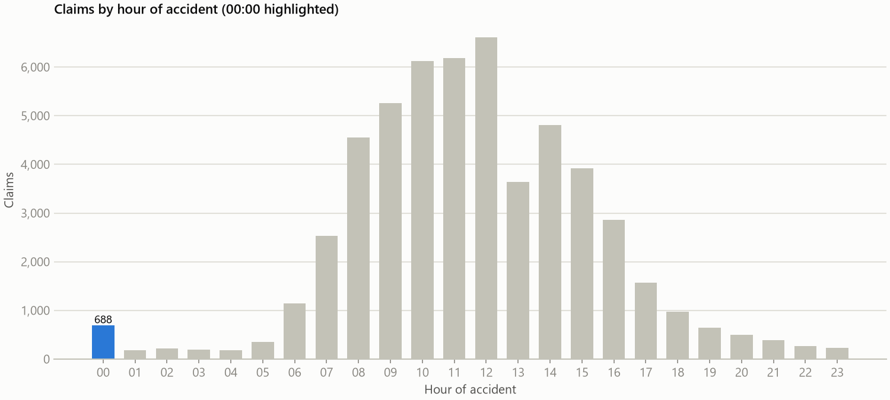
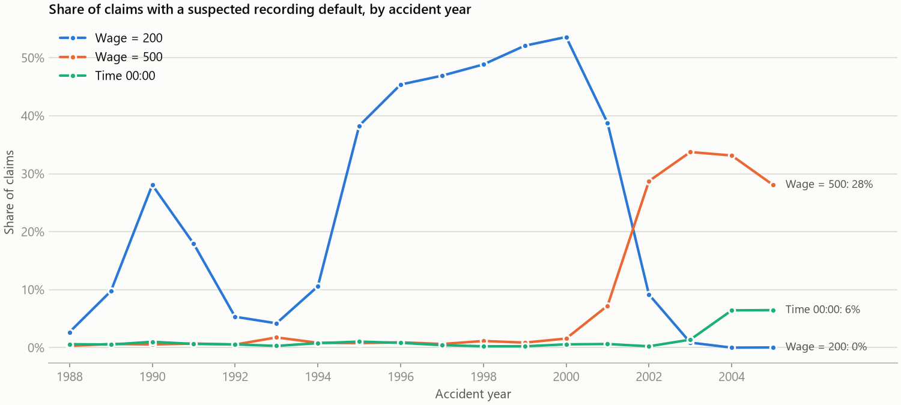
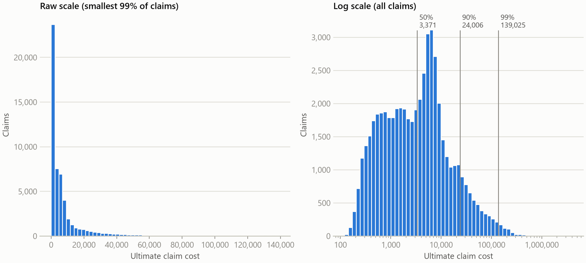

# Data Quality Report

_Generated by `python -m src.pipeline --stage validate`. Do not edit by hand._

## Summary

- The raw file has **54,000 claims and 15 columns**; every expected column is present, with no unexpected columns.
- Columns with missing values in the raw file: MaritalStatus (29).
- Duplicates found: 0 (exact rows, claim numbers, or rows identical apart from the claim number).
- **7 cleaning rules changed data**, making 541 value edits; 0 rows were dropped, leaving 54,000.
- **12 further checks** found unusual but plausible values that were kept as recorded.

## 1. Schema, dtypes and missing values

Dates arrive as text and are parsed with a fixed format; numeric columns are coerced to numbers. *Unparseable* counts values that were present but could not be parsed.

| Column                    | Raw dtype   | Parsed dtype   |   Missing |   Unparseable |   Unique values |
|:--------------------------|:------------|:---------------|----------:|--------------:|----------------:|
| ClaimNumber               | str         | str            |         0 |             0 |           54000 |
| DateTimeOfAccident        | str         | datetime64[us] |         0 |             0 |           36673 |
| DateReported              | str         | datetime64[us] |         0 |             0 |            6653 |
| Age                       | int64       | int64          |         0 |             0 |              68 |
| Gender                    | str         | str            |         0 |             0 |               3 |
| MaritalStatus             | str         | str            |        29 |             0 |               3 |
| DependentChildren         | int64       | int64          |         0 |             0 |               9 |
| DependentsOther           | int64       | int64          |         0 |             0 |               5 |
| WeeklyWages               | float64     | float64        |         0 |             0 |           13211 |
| PartTimeFullTime          | str         | str            |         0 |             0 |               2 |
| HoursWorkedPerWeek        | float64     | float64        |         0 |             0 |             424 |
| DaysWorkedPerWeek         | int64       | int64          |         0 |             0 |               7 |
| ClaimDescription          | str         | str            |         0 |             0 |           28114 |
| InitialIncurredCalimsCost | int64       | int64          |         0 |             0 |            1989 |
| UltimateIncurredClaimCost | float64     | float64        |         0 |             0 |           53999 |

### Duplicates

| Check                                      |   Rows |
|:-------------------------------------------|-------:|
| Exact duplicate rows                       |      0 |
| Duplicate claim numbers                    |      0 |
| Rows identical apart from the claim number |      0 |

## 2. Cleaning rules

Rules run in the order listed; each count is the number of rows affected at that step, as a share of all raw rows. Every threshold is fixed in `config/config.yaml` from domain limits, never from the relationship with the target, and nothing is learned from the data, so the same function is applied unchanged to new claims in the app.

**Scope of this audit.** It inspects all rows, including the most recent period that later becomes the test set. That is acceptable for fixed validity rules like these (they describe whether a value is possible, not how it relates to cost), but no statistic learned here is ever used by a model.

**Why values are set to missing instead of filled here.** Filling a value with a median or mode learns something from the data. If that were done on the full dataset, information from the test period would leak into training. So this stage only marks bad values as missing; Phase 3 imputes them inside the model pipeline, fitted on training rows only.

### Rules that change the data

| Column                    | Issue                                                                 |   Rows | % of rows   | Action                                                                  | Rationale                                                                                                                                                                                                                           |
|:--------------------------|:----------------------------------------------------------------------|-------:|:------------|:------------------------------------------------------------------------|:------------------------------------------------------------------------------------------------------------------------------------------------------------------------------------------------------------------------------------|
| ClaimNumber               | Duplicate claim number                                                |      0 | 0.00        | Dropped (first occurrence kept)                                         | A claim number identifies one claim. A duplicate would be counted twice and could land in both the training and the test set.                                                                                                       |
| UltimateIncurredClaimCost | Ultimate cost missing or not positive                                 |      0 | 0.00        | Dropped                                                                 | A claim without a positive final cost cannot be used to train or evaluate a cost model.                                                                                                                                             |
| DateTimeOfAccident        | Accident date missing or unparseable                                  |      0 | 0.00        | Dropped                                                                 | The accident date orders claims for the time-based split and drives the calendar features, so a claim cannot be used without it.                                                                                                    |
| DateReported              | Report date earlier than accident date                                |      0 | 0.00        | Report date set to missing                                              | A claim cannot be reported before the accident. Rather than guess which date is wrong, the report date is treated as unknown.                                                                                                       |
| HoursWorkedPerWeek        | Hours worked per week is 0 or negative                                |     29 | 0.05        | Set to missing (imputed in the model pipeline)                          | Every claimant was working when injured, so 0 hours is a missing value recorded as 0. It is imputed later with the median of the same part-time / full-time group, learned from training rows only.                                 |
| HoursWorkedPerWeek        | Hours worked per week above 100                                       |     37 | 0.07        | Set to missing (imputed in the model pipeline)                          | More than 100 hours a week means over 14 hours every day. Several values look like a misplaced decimal point (380 for 38.0), but guessing the correction is riskier than imputing a typical value.                                  |
| DaysWorkedPerWeek         | Days worked per week outside 1-7                                      |      0 | 0.00        | Set to missing (imputed in the model pipeline)                          | A week has seven days and every claimant worked at least one.                                                                                                                                                                       |
| DaysWorkedPerWeek         | More than 24 hours per working day (hours / days)                     |     17 | 0.03        | Days worked set to missing (imputed in the model pipeline)              | More than 24 hours in a day is impossible, so one of the two fields is wrong. Most of these rows are a standard full-time week (such as 38 hours) recorded against a single working day, so the days value is treated as the error. |
| WeeklyWages               | Weekly wage below 10                                                  |    195 | 0.36        | Set to missing (imputed in the model pipeline)                          | No real job pays under 10 a week, whatever the hours. Values such as 1.0 look like placeholders entered when the wage was unknown.                                                                                                  |
| WeeklyWages               | Implied hourly wage below 1.0 (weekly wage / hours)                   |    232 | 0.43        | Weekly wage set to missing (imputed in the model pipeline)              | An hourly rate this low is far below any minimum or junior wage in the period, so the wage was mis-recorded for the hours worked.                                                                                                   |
| Gender                    | Gender missing or not one of M, F, U                                  |      0 | 0.00        | Set to U                                                                | U (unknown) is already a category, so blanks and unrecognised codes join it instead of being guessed.                                                                                                                               |
| MaritalStatus             | MaritalStatus missing or not one of M, S, U                           |     29 | 0.05        | Set to U                                                                | U (unknown) is already a category, so blanks and unrecognised codes join it instead of being guessed.                                                                                                                               |
| PartTimeFullTime          | PartTimeFullTime missing or not one of P, F                           |      0 | 0.00        | Set to missing (imputed in the model pipeline)                          | No safe default exists, so the value is imputed in the model pipeline.                                                                                                                                                              |
| ClaimDescription          | Claim description missing or empty                                    |      0 | 0.00        | Filled with an empty string                                             | Text features need a string; an empty description simply matches no keywords.                                                                                                                                                       |
| ClaimDescription          | Claim description has encoding errors, extra whitespace or lower case |      2 | <0.01       | Normalised (bad characters replaced, whitespace collapsed, upper-cased) | Keyword rules and TF-IDF match exact tokens, so every description needs one consistent form.                                                                                                                                        |

### Checks that leave the data unchanged

| Column                    | Issue                                          |   Rows | % of rows   | Action                                                    | Rationale                                                                                                                                                                                                                                                    |
|:--------------------------|:-----------------------------------------------|-------:|:------------|:----------------------------------------------------------|:-------------------------------------------------------------------------------------------------------------------------------------------------------------------------------------------------------------------------------------------------------------|
| DateReported              | Report date missing or unparseable             |      0 | 0.00        | Left missing (report delay imputed in the model pipeline) | The claim is still usable; only the report delay is unknown.                                                                                                                                                                                                 |
| DateReported              | Reported more than 365 days after the accident |    359 | 0.66        | None (kept as recorded)                                   | Late reporting is real and is a known cost driver in workers' compensation, so it is kept as information, not treated as an error.                                                                                                                           |
| Gender                    | Gender recorded as U (unknown)                 |      2 | <0.01       | None (kept as recorded)                                   | A legitimate category. It is kept as its own level rather than imputed, so the model can learn whether 'unknown' itself carries signal.                                                                                                                      |
| MaritalStatus             | MaritalStatus recorded as U (unknown)          |   5294 | 9.80        | None (kept as recorded)                                   | A legitimate category. It is kept as its own level rather than imputed, so the model can learn whether 'unknown' itself carries signal.                                                                                                                      |
| Age                       | Age below 16                                   |    201 | 0.37        | None (kept as recorded)                                   | Plausible: school-age part-time work is legal in some jurisdictions.                                                                                                                                                                                         |
| Age                       | Age above 70                                   |     41 | 0.08        | None (kept as recorded)                                   | Plausible: some people keep working past typical retirement age.                                                                                                                                                                                             |
| WeeklyWages               | Weekly wage above 2,000                        |     66 | 0.12        | None (kept as recorded)                                   | Plausible for senior or specialist roles. Linear models use log wages, so these values do not dominate, and tree models are unaffected by scale.                                                                                                             |
| WeeklyWages               | Weekly wage exactly 200                        |  12372 | 22.91       | None (kept as recorded)                                   | An exact value this common, concentrated in particular accident years (see the figure below), looks like a system default rather than a real wage. It is too common to discard; Phase 3 adds an indicator so models can learn that the wage may not be real. |
| WeeklyWages               | Weekly wage exactly 500                        |   4271 | 7.91        | None (kept as recorded)                                   | An exact value this common, concentrated in particular accident years (see the figure below), looks like a system default rather than a real wage. It is too common to discard; Phase 3 adds an indicator so models can learn that the wage may not be real. |
| PartTimeFullTime          | Part-time with at least 38 hours a week        |    714 | 1.32        | None (kept as recorded)                                   | The part-time label may describe the contract rather than the hours, so both fields are kept as recorded.                                                                                                                                                    |
| PartTimeFullTime          | Full-time with fewer than 20 hours a week      |    228 | 0.42        | None (kept as recorded)                                   | The part-time label may describe the contract rather than the hours, so both fields are kept as recorded.                                                                                                                                                    |
| DateTimeOfAccident        | Accident time recorded as exactly 00:00        |    688 | 1.27        | None (kept as recorded)                                   | Far more accidents are timed at 00:00 than in the hours around it (see the figure below), which suggests 'time unknown' stored as midnight. Phase 3 adds a flag for it.                                                                                      |
| InitialIncurredCalimsCost | Initial estimate of 1 or less                  |     46 | 0.09        | None (kept as recorded)                                   | A nominal placeholder rather than a cost estimate. Kept as recorded because the initial-estimate baseline must reflect what adjusters actually entered. Phase 3 adds an indicator.                                                                           |

### Example rows affected by each data-changing rule

Up to 5 rows per rule, shown as they were before the rule ran. *Row* is the 0-based data row in `train.csv` (header excluded).

**Hours worked per week is 0 or negative**

|   Row |   HoursWorkedPerWeek |   DaysWorkedPerWeek | PartTimeFullTime   |
|------:|---------------------:|--------------------:|:-------------------|
|   589 |                 0.00 |                   3 | F                  |
|  1819 |                 0.00 |                   6 | F                  |
|  3227 |                 0.00 |                   5 | F                  |
|  3453 |                 0.00 |                   5 | F                  |
|  6803 |                 0.00 |                   5 | F                  |

**Hours worked per week above 100**

|   Row |   HoursWorkedPerWeek |   DaysWorkedPerWeek | PartTimeFullTime   |
|------:|---------------------:|--------------------:|:-------------------|
|  3691 |               250.00 |                   5 | F                  |
|  4671 |               410.00 |                   5 | F                  |
|  5232 |               168.00 |                   5 | F                  |
|  5488 |               389.00 |                   7 | F                  |
|  6131 |               417.20 |                   5 | P                  |

**More than 24 hours per working day (hours / days)**

|   Row |   HoursWorkedPerWeek |   DaysWorkedPerWeek | PartTimeFullTime   |
|------:|---------------------:|--------------------:|:-------------------|
|  2484 |                38.00 |                   1 | F                  |
|  4415 |                38.00 |                   1 | F                  |
|  6071 |                40.00 |                   1 | F                  |
|  7237 |                71.00 |                   2 | F                  |
| 11322 |                80.00 |                   3 | F                  |

**Weekly wage below 10**

|   Row |   WeeklyWages |   HoursWorkedPerWeek | PartTimeFullTime   |
|------:|--------------:|---------------------:|:-------------------|
|   324 |          1.00 |                40.00 | F                  |
|   662 |          3.95 |                42.00 | F                  |
|   904 |          1.00 |                40.00 | F                  |
|  1069 |          3.95 |                40.00 | F                  |
|  1102 |          1.00 |                10.00 | F                  |

**Implied hourly wage below 1.0 (weekly wage / hours)**

|   Row |   WeeklyWages |   HoursWorkedPerWeek | PartTimeFullTime   |
|------:|--------------:|---------------------:|:-------------------|
|   136 |         15.09 |                35.00 | F                  |
|   482 |         11.66 |                12.00 | P                  |
|   618 |         12.59 |                16.40 | P                  |
|  1067 |         17.35 |                27.00 | P                  |
|  1119 |         13.15 |                38.00 | F                  |

**MaritalStatus missing or not one of M, S, U**

|   Row | MaritalStatus   |
|------:|:----------------|
|  1042 | nan             |
|  7587 | nan             |
|  7592 | nan             |
| 10482 | nan             |
| 10555 | nan             |

**Claim description has encoding errors, extra whitespace or lower case**

|   Row | ClaimDescription                                       |
|------:|:-------------------------------------------------------|
| 28636 | CAUGHT �� BAR AND MOULD SOFT TISSUE INJURY RIGHT ELBOW |
| 36094 | CAUGHT �� BAR AND SLIPPED LACERATION LEFT HAND         |

## 3. Recording artifacts

Some values look like system defaults rather than real measurements. They are not errors to delete, but a model must not take them at face value.

**Takeaway.** 688 accidents are timed at exactly 00:00, against an average of 195 per hour between 01:00 and 04:00. 57% of the 00:00 claims come from the last 2 accident years (2004-2005), which points to a change in how unknown times were recorded rather than a real spike in midnight injuries.

**Takeaway.** Wage = 200 goes from 3% of claims in 1988 to a peak of 54% in 2000, then 0% in 2005; Wage = 500 goes from 0% of claims in 1988 to a peak of 34% in 2003, then 28% in 2005; Time 00:00 goes from 1% of claims in 1988 to 6% in 2005. These defaults come and go with the accident year, so they differ between the earlier training period and the most recent test period. Models need an indicator for each one rather than treating the value as real.

|   Accident year |   Claims | Wage = 200   | Wage = 500   | Time 00:00   |
|----------------:|---------:|:-------------|:-------------|:-------------|
|            1988 |     3023 | 2.7%         | 0.3%         | 0.6%         |
|            1989 |     2977 | 9.7%         | 0.6%         | 0.5%         |
|            1990 |     2971 | 28.1%        | 0.5%         | 1.0%         |
|            1991 |     2973 | 17.9%        | 0.7%         | 0.6%         |
|            1992 |     3022 | 5.3%         | 0.5%         | 0.6%         |
|            1993 |     3003 | 4.2%         | 1.8%         | 0.3%         |
|            1994 |     2981 | 10.6%        | 0.8%         | 0.8%         |
|            1995 |     2983 | 38.3%        | 0.8%         | 1.0%         |
|            1996 |     3034 | 45.4%        | 0.9%         | 0.8%         |
|            1997 |     3031 | 46.9%        | 0.6%         | 0.4%         |
|            1998 |     2964 | 48.9%        | 1.1%         | 0.2%         |
|            1999 |     2999 | 52.1%        | 0.9%         | 0.2%         |
|            2000 |     2993 | 53.6%        | 1.6%         | 0.6%         |
|            2001 |     3028 | 38.8%        | 7.2%         | 0.6%         |
|            2002 |     3011 | 9.2%         | 28.7%        | 0.2%         |
|            2003 |     2978 | 0.9%         | 33.7%        | 1.4%         |
|            2004 |     3032 | 0.0%         | 33.1%        | 6.4%         |
|            2005 |     2997 | 0.0%         | 28.1%        | 6.5%         |

## 4. Target: `UltimateIncurredClaimCost`

**Takeaway.** Ultimate cost runs from 122 to 4,027,136. The mean (11,003) is 3.3 times the median (3,371), and skewness falls from 37.6 on the raw scale to 0.29 after a log transform. Of all claim cost, the largest 1% carry 21% and the largest 10% carry 63%, so any error measured in currency is dominated by a small number of very large claims.

| Percentile   |   Ultimate cost |   log1p(cost) |
|:-------------|----------------:|--------------:|
| 1%           |             208 |          5.34 |
| 5%           |             307 |          5.73 |
| 10%          |             424 |          6.05 |
| 25%          |             926 |          6.83 |
| 50%          |           3,371 |          8.12 |
| 75%          |           8,197 |          9.01 |
| 90%          |          24,006 |         10.09 |
| 95%          |          45,224 |         10.72 |
| 99%          |         139,025 |         11.84 |
| 99.9%        |         333,002 |         12.72 |

**The target is not capped.** The largest claims are real and are exactly the ones the high-cost classifier must find, so removing or capping them would hide the problem the project exists to solve. The skew is handled by the modelling choices instead: log-scale targets and Tweedie/Gamma losses (Phase 5), and metrics reported on both scales.

## 5. What this means for modelling

- **Imputation happens later, on training rows only.** Values set to missing: DaysWorkedPerWeek (17), HoursWorkedPerWeek (66), WeeklyWages (427). Phase 3 imputes them inside the scikit-learn pipeline (median within the part-time / full-time group) and adds missing-value indicators.
- **The target needs a log scale or a skew-aware loss.** Skewness is 37.6 raw versus 0.29 on log1p. Original-scale RMSE will be dominated by the largest claims, so it is reported alongside log-scale metrics.
- **Recording defaults need indicator features.** The heaped wage values and the 00:00 accident time change with the accident year, so they will look different in the time-based test period than in training.
- **Initial estimates of 1 are kept as recorded**, because the adjuster baseline must use what adjusters actually entered.
