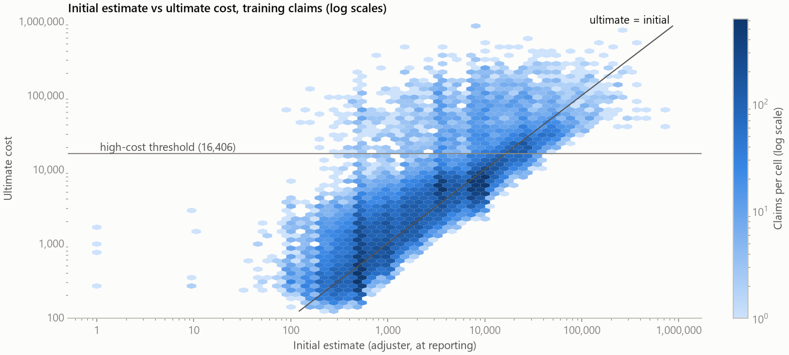
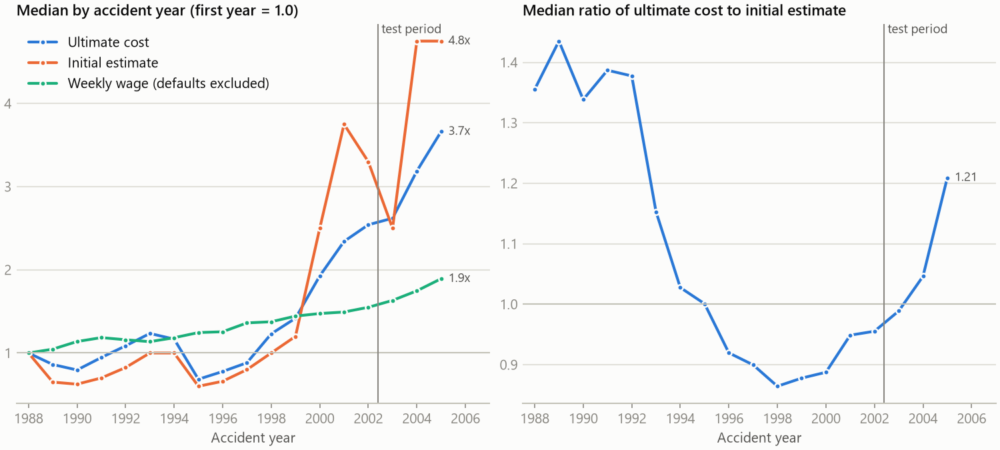

# Exploratory Data Analysis

_Generated by `python -m src.pipeline --stage eda`. Do not edit by hand._

**Scope.** Sections 1-4 use the training period only: 43,200 claims with accidents from 01 Jan 1988 to 29 May 2002. The 10,800 most recent claims (accidents from 29 May 2002) are the test set and are left out, so that what is learned here cannot leak into choices evaluated on them. Section 5 is the exception (see there).

**High-cost claims** are those at or above the 90% percentile of ultimate cost in the training period: **16,406**.

## 1. How good are adjusters' initial estimates?

This is the question that motivates the project: if the estimate recorded at reporting time were already accurate, there would be nothing to improve.

**Takeaway.** Points spread widely around the diagonal: the typical claim's initial estimate is off by a factor of 1.52 (median absolute error 41% of the final cost), and only 32% of estimates land within ±25%. The vertical stripes are round-number estimates: the three most common values (500, 10,000, 3,500) alone make up 27% of claims, which suggests many initial reserves are set to standard amounts rather than assessed individually.

| Measure                                                  | Value   |
|:---------------------------------------------------------|:--------|
| Median ratio ultimate / initial                          | 1.07    |
| Median absolute error, as % of ultimate                  | 41%     |
| Share of estimates within ±25%                           | 32%     |
| Share under-estimated by more than 2x                    | 22%     |
| Share over-estimated by more than 2x                     | 5%      |
| Sum of initial estimates / sum of ultimate costs         | 70%     |
| Rank correlation (Spearman) initial vs ultimate          | 0.87    |
| High-cost claims whose initial estimate was also top 10% | 68%     |

The initial estimate is informative (rank correlation 0.87) but imprecise. Of the claims that end up in the top 10% by ultimate cost, 68% already had an initial estimate in the top 10%; the other **32% looked ordinary at reporting time**. Those are the claims that get escalated late, and the ones the high-cost flag is meant to catch. (Formal baseline metrics come in Phase 5.)

## 2. Most frequent vs most expensive injury types

Injury types come from the rule-based keyword taxonomy on the claim description (`src/features/text_rules.py`; keyword lists in `config/config.yaml`). This is a first pass: Phase 3 measures its coverage and refines it, and this report is regenerated with the refined rules. Groups are sorted by frequency with *other* (no keyword matched) last; 'most expensive' only considers groups with at least 100 claims.

### Injury nature

**Takeaway.** The most frequent injury nature is **strain** (27% of claims, median 6,010), but the most expensive is **psychological** (median 18,745, 6.6x the overall median of 2,819). Frequency and severity rank differently. **Strain** carries the largest share of total cost (41%). At the other end, **foreign body** claims have a median of only 364.

| Injury nature   |   Claims | Share of claims   |   Median cost |   Mean cost | Share of total cost   | High-cost rate   |
|:----------------|---------:|:------------------|--------------:|------------:|:----------------------|:-----------------|
| strain          |    11675 | 27.0%             |         6,010 |      12,773 | 41.2%                 | 14.7%            |
| laceration      |     9054 | 21.0%             |           694 |       3,112 | 7.8%                  | 3.1%             |
| contusion       |     2547 | 5.9%              |         1,304 |       4,843 | 3.4%                  | 5.3%             |
| foreign body    |     2462 | 5.7%              |           364 |       1,407 | 1.0%                  | 1.3%             |
| fracture        |     2405 | 5.6%              |         3,486 |       9,891 | 6.6%                  | 13.9%            |
| sprain          |     2155 | 5.0%              |         3,049 |       8,134 | 4.8%                  | 10.1%            |
| burn            |     1298 | 3.0%              |           707 |       2,925 | 1.0%                  | 3.2%             |
| inflammation    |     1076 | 2.5%              |         3,739 |       9,865 | 2.9%                  | 14.1%            |
| soft tissue     |     1045 | 2.4%              |         5,411 |      15,371 | 4.4%                  | 14.7%            |
| pain            |     1013 | 2.3%              |         6,457 |      14,728 | 4.1%                  | 16.4%            |
| crush           |      865 | 2.0%              |         2,215 |       7,097 | 1.7%                  | 10.2%            |
| puncture        |      857 | 2.0%              |         1,231 |       4,703 | 1.1%                  | 5.4%             |
| infection       |      261 | 0.6%              |         1,449 |       6,249 | 0.5%                  | 8.4%             |
| hernia          |      186 | 0.4%              |        10,492 |      16,825 | 0.9%                  | 26.3%            |
| bite sting      |      181 | 0.4%              |         1,509 |       5,028 | 0.3%                  | 7.2%             |
| psychological   |      145 | 0.3%              |        18,745 |      28,670 | 1.1%                  | 57.2%            |
| dermatitis      |      119 | 0.3%              |         2,048 |       7,095 | 0.2%                  | 11.8%            |
| amputation      |       84 | 0.2%              |         2,771 |       9,548 | 0.2%                  | 20.2%            |
| other           |     5772 | 13.4%             |         3,867 |      10,508 | 16.8%                 | 13.2%            |

### Body part

**Takeaway.** The most frequent body part is **multiple** (23% of claims, median 2,845), but the most expensive is **back** (median 6,578, 2.3x the overall median of 2,819). Frequency and severity rank differently. **Back** carries the largest share of total cost (33%). At the other end, **eye** claims have a median of only 396.

| Body part   |   Claims | Share of claims   |   Median cost |   Mean cost | Share of total cost   | High-cost rate   |
|:------------|---------:|:------------------|--------------:|------------:|:----------------------|:-----------------|
| multiple    |    10123 | 23.4%             |         2,845 |       8,216 | 23.0%                 | 10.2%            |
| back        |     8213 | 19.0%             |         6,578 |      14,343 | 32.5%                 | 15.6%            |
| finger      |     6544 | 15.1%             |           700 |       3,413 | 6.2%                  | 3.9%             |
| eye         |     3254 | 7.5%              |           396 |       1,466 | 1.3%                  | 1.3%             |
| hand        |     2375 | 5.5%              |         1,026 |       5,201 | 3.4%                  | 5.1%             |
| shoulder    |     1910 | 4.4%              |         5,503 |      12,935 | 6.8%                  | 16.8%            |
| arm         |     1841 | 4.3%              |         2,210 |       7,571 | 3.8%                  | 9.3%             |
| knee        |     1807 | 4.2%              |         4,241 |      12,473 | 6.2%                  | 16.7%            |
| foot        |     1274 | 2.9%              |         2,003 |       7,301 | 2.6%                  | 8.3%             |
| ankle       |     1125 | 2.6%              |         2,276 |       6,034 | 1.9%                  | 8.2%             |
| wrist       |     1105 | 2.6%              |         3,007 |       9,169 | 2.8%                  | 13.0%            |
| head        |      773 | 1.8%              |         1,673 |       7,594 | 1.6%                  | 7.5%             |
| leg         |      755 | 1.7%              |         1,527 |       5,747 | 1.2%                  | 8.3%             |
| neck        |      646 | 1.5%              |         4,918 |      10,528 | 1.9%                  | 11.9%            |
| trunk       |      491 | 1.1%              |         4,421 |      10,708 | 1.5%                  | 14.3%            |
| other       |      964 | 2.2%              |         3,613 |      12,449 | 3.3%                  | 19.0%            |

### Injury cause

| Injury cause     |   Claims | Share of claims   |   Median cost |   Mean cost | Share of total cost   | High-cost rate   |
|:-----------------|---------:|:------------------|--------------:|------------:|:----------------------|:-----------------|
| slip fall        |     9335 | 21.6%             |         3,195 |       9,311 | 24.0%                 | 11.3%            |
| lifting          |     7440 | 17.2%             |         6,233 |      12,994 | 26.7%                 | 14.7%            |
| struck by        |     6813 | 15.8%             |           827 |       4,356 | 8.2%                  | 5.1%             |
| tool use         |     3157 | 7.3%              |           641 |       3,161 | 2.8%                  | 3.1%             |
| caught in        |     2236 | 5.2%              |         1,770 |       6,900 | 4.3%                  | 9.0%             |
| bending twisting |     1341 | 3.1%              |         5,158 |      10,623 | 3.9%                  | 13.3%            |
| exposure         |     1027 | 2.4%              |           689 |       3,209 | 0.9%                  | 3.2%             |
| vehicle          |      870 | 2.0%              |         5,716 |      14,653 | 3.5%                  | 14.9%            |
| repetitive       |      845 | 2.0%              |         6,988 |      15,175 | 3.5%                  | 21.9%            |
| animal insect    |      432 | 1.0%              |         2,119 |       6,427 | 0.8%                  | 7.4%             |
| assault          |      114 | 0.3%              |         2,967 |      12,737 | 0.4%                  | 13.2%            |
| other            |     9590 | 22.2%             |         2,472 |       7,933 | 21.0%                 | 9.9%             |

## 3. Cost vs reporting delay

**Takeaway.** The relationship is not a straight line. Median cost is 1,913 for claims reported in under a week, peaks at 3,095 for 15-30 days, eases off, then jumps to 6,183 for the 0.7% of claims reported after more than a year. The high-cost rate climbs more steadily, from 7% to 27%. The overall rank correlation is weak (0.03) because the effect sits in the tails, which a tree model can pick up but a single linear term would miss.

| Days to report   |   Claims | Share of claims   |   Median cost |   Mean cost | Share of total cost   | High-cost rate   |
|:-----------------|---------:|:------------------|--------------:|------------:|:----------------------|:-----------------|
| <8               |     2618 | 6.1%              |         1,913 |       6,836 | 4.9%                  | 7.0%             |
| 8-14             |     9036 | 20.9%             |         2,545 |       7,436 | 18.6%                 | 8.5%             |
| 15-30            |    15817 | 36.6%             |         3,095 |       8,452 | 36.9%                 | 9.8%             |
| 31-60            |     9265 | 21.4%             |         3,033 |       9,011 | 23.1%                 | 10.8%            |
| 61-90            |     2914 | 6.7%              |         2,690 |       8,786 | 7.1%                  | 11.4%            |
| 91-180           |     2380 | 5.5%              |         2,465 |       8,368 | 5.5%                  | 11.5%            |
| 181-365          |      866 | 2.0%              |         2,404 |      10,094 | 2.4%                  | 15.6%            |
| 366+             |      304 | 0.7%              |         6,183 |      18,348 | 1.5%                  | 27.3%            |

## 4. Cost vs age, wage, part-time status and dependents

**Takeaway.** Median cost ranges by age band from 1,124 (<20) to 5,242 (60-64), 4.7x; by weekly wage band from 1,448 (200-300) to 8,120 (1,500+), 5.6x; by part-time / full-time from 2,750 (full-time) to 3,520 (part-time), 1.3x; by total dependents from 2,762 (0) to 3,686 (1), 1.3x. The widest spreads are by weekly wage band (5.6x) and age band (4.7x); the narrowest by total dependents (1.3x) and part-time / full-time (1.3x). These are unadjusted comparisons: groups can also differ in injury type, which the model untangles by using all features together.

**Age band**

| Age band   |   Claims | Share of claims   |   Median cost |   Mean cost | Share of total cost   | High-cost rate   |
|:-----------|---------:|:------------------|--------------:|------------:|:----------------------|:-----------------|
| <20        |     4616 | 10.7%             |         1,124 |       4,559 | 5.8%                  | 4.4%             |
| 20-24      |     7923 | 18.3%             |         1,805 |       6,163 | 13.5%                 | 6.4%             |
| 25-29      |     6797 | 15.7%             |         2,343 |       6,963 | 13.1%                 | 7.8%             |
| 30-34      |     5790 | 13.4%             |         3,040 |       8,633 | 13.8%                 | 10.4%            |
| 35-39      |     4918 | 11.4%             |         3,893 |      10,416 | 14.1%                 | 12.6%            |
| 40-44      |     4299 | 10.0%             |         4,118 |       9,523 | 11.3%                 | 12.8%            |
| 45-49      |     3677 | 8.5%              |         4,490 |      10,899 | 11.1%                 | 14.2%            |
| 50-54      |     2584 | 6.0%              |         4,652 |      11,015 | 7.9%                  | 13.9%            |
| 55-59      |     1647 | 3.8%              |         5,106 |      13,179 | 6.0%                  | 16.7%            |
| 60-64      |      761 | 1.8%              |         5,242 |      13,989 | 2.9%                  | 16.7%            |
| 65+        |      188 | 0.4%              |         4,807 |       9,899 | 0.5%                  | 13.8%            |

**Weekly wage band**

| Weekly wage band   |   Claims | Share of claims   |   Median cost |   Mean cost | Share of total cost   | High-cost rate   |
|:-------------------|---------:|:------------------|--------------:|------------:|:----------------------|:-----------------|
| <200               |     1890 | 4.4%              |         1,667 |       5,875 | 3.1%                  | 5.8%             |
| 200-300            |    15772 | 36.5%             |         1,448 |       5,786 | 25.2%                 | 6.5%             |
| 300-400            |     8281 | 19.2%             |         2,662 |       7,083 | 16.2%                 | 7.4%             |
| 400-500            |     7601 | 17.6%             |         3,630 |       9,131 | 19.2%                 | 10.2%            |
| 500-750            |     7408 | 17.1%             |         5,435 |      12,584 | 25.7%                 | 17.2%            |
| 750-1,000          |     1435 | 3.3%              |         7,779 |      19,879 | 7.9%                  | 27.8%            |
| 1,000-1,500        |      311 | 0.7%              |         6,429 |      17,655 | 1.5%                  | 22.8%            |
| 1,500+             |       81 | 0.2%              |         8,120 |      12,884 | 0.3%                  | 24.7%            |

**Part-time / full-time**

| Part-time / full-time   |   Claims | Share of claims   |   Median cost |   Mean cost | Share of total cost   | High-cost rate   |
|:------------------------|---------:|:------------------|--------------:|------------:|:----------------------|:-----------------|
| F                       |    39626 | 91.7%             |         2,750 |       8,216 | 89.9%                 | 9.8%             |
| P                       |     3574 | 8.3%              |         3,520 |      10,225 | 10.1%                 | 12.4%            |

**Total dependents**

| Total dependents   |   Claims | Share of claims   |   Median cost |   Mean cost | Share of total cost   | High-cost rate   |
|:-------------------|---------:|:------------------|--------------:|------------:|:----------------------|:-----------------|
| 0                  |    40544 | 93.9%             |         2,762 |       8,232 | 92.2%                 | 9.8%             |
| 1                  |      949 | 2.2%              |         3,686 |      10,916 | 2.9%                  | 14.2%            |
| 2                  |     1012 | 2.3%              |         3,318 |      10,585 | 3.0%                  | 11.1%            |
| 3+                 |      695 | 1.6%              |         3,580 |      10,486 | 2.0%                  | 13.1%            |

**Suspected default wages.** Claims whose wage equals a suspected system default (see the data quality report) are compared with all other claims below. If their cost differs markedly, the default value is carrying information about the recording era rather than about the worker's pay, which is why Phase 3 adds an indicator for it.

| Weekly wage   |   Claims | Share of claims   |   Median cost |   Mean cost | Share of total cost   | High-cost rate   |
|:--------------|---------:|:------------------|--------------:|------------:|:----------------------|:-----------------|
| Exactly 200   |    12266 | 28.4%             |         1,182 |       5,223 | 17.7%                 | 5.7%             |
| Exactly 500   |      833 | 1.9%              |         5,351 |      12,840 | 3.0%                  | 17.9%            |
| Other wages   |    30101 | 69.7%             |         3,561 |       9,546 | 79.4%                 | 11.5%            |

## 5. Trends over accident year (all claims)

This section uses every accident year, including the test period, because its purpose is to describe how the test period differs from training. Nothing here is used to fit or tune a model; the choice between modelling approaches is made with time-ordered cross-validation inside the training period (Phase 4).

### Claim counts and costs

**Takeaway.** Claim counts are flat (about 3,000 a year), but costs are not: the median rises from 2,569 in 1988 to 9,408 in 2005 (3.7x) and the mean from 6,273 to 27,354. The test period (right of the line) is the most expensive part of the data, so a model trained on earlier years risks under-predicting it unless it is anchored to current prices.

### Price change or mix change?

Costs can rise because the same injury costs more (price change, which needs trending or anchoring) or because more serious injuries are being claimed (mix change, which the injury features already capture). A regression of log cost on accident year, with and without controls for the claim mix, separates the two.

**Takeaway.** The typical claim in 2005 costs 3.57x a 1988 claim. Holding injury type, body part, cause, age band and part-time status fixed, it still costs 3.63x, so changes in claim mix explain essentially none of the growth: the rise behaves like a change in price level (inflation), not a shift towards more serious claims. The path is uneven, with a low of 0.73x in 1995 before a steep climb.

### Does the initial estimate track the price level?

**Takeaway.** From 1988 to 2005 the median ultimate cost grows 3.7x, the median initial estimate 4.8x (jumpy, because estimates cluster on round numbers) and the median non-default wage only 1.9x. So the initial estimate carries most of the price level, but it is not a perfect anchor: the median ultimate/initial ratio falls from 1.36 in 1988 to 0.86 in 1998, then recovers to 1.21 in 2005. That range (0.86-1.44) is much narrower than the cost index range (0.73-3.57x), and the training and test periods have similar medians (1.07 vs 1.05). Modelling the ratio (approach B) should reduce the drift problem but will not remove it, which is why approach C (explicit trending) is also tested.

|   Accident year |   Claims |   Median cost |   Mean cost |   Raw (all claims) |   Mix-adjusted |   Median ultimate / initial |
|----------------:|---------:|--------------:|------------:|-------------------:|---------------:|----------------------------:|
|            1988 |    3,023 |         2,569 |       6,273 |               1.00 |           1.00 |                        1.36 |
|            1989 |    2,977 |         2,213 |       6,331 |               0.90 |           0.91 |                        1.44 |
|            1990 |    2,971 |         2,044 |       5,542 |               0.83 |           0.86 |                        1.34 |
|            1991 |    2,973 |         2,429 |       6,292 |               0.94 |           0.94 |                        1.39 |
|            1992 |    3,022 |         2,789 |       7,285 |               1.05 |           1.04 |                        1.38 |
|            1993 |    3,003 |         3,173 |       7,737 |               1.18 |           1.13 |                        1.15 |
|            1994 |    2,981 |         2,998 |       7,847 |               1.17 |           1.28 |                        1.03 |
|            1995 |    2,983 |         1,758 |       5,959 |               0.73 |           0.89 |                        1.00 |
|            1996 |    3,034 |         1,998 |       6,220 |               0.78 |           0.96 |                        0.92 |
|            1997 |    3,031 |         2,268 |       7,064 |               0.88 |           1.06 |                        0.90 |
|            1998 |    2,964 |         3,160 |       7,927 |               0.98 |           1.17 |                        0.86 |
|            1999 |    2,999 |         3,643 |       9,415 |               1.15 |           1.28 |                        0.88 |
|            2000 |    2,993 |         4,950 |      13,639 |               1.51 |           1.60 |                        0.89 |
|            2001 |    3,028 |         6,015 |      16,106 |               1.92 |           1.97 |                        0.95 |
|            2002 |    3,011 |         6,530 |      16,793 |               2.22 |           2.35 |                        0.96 |
|            2003 |    2,978 |         6,732 |      17,764 |               2.33 |           2.53 |                        0.99 |
|            2004 |    3,032 |         8,189 |      22,339 |               2.95 |           3.00 |                        1.05 |
|            2005 |    2,997 |         9,408 |      27,354 |               3.57 |           3.63 |                        1.21 |

## Key findings

1. **Adjusters' initial estimates are informative but imprecise.** The typical estimate is off by a factor of 1.52, only 32% are within ±25%, and 32% of eventual high-cost claims did not have a top-10% initial estimate.
2. **Injury nature.** The most frequent injury nature is **strain** (27% of claims, median 6,010), but the most expensive is **psychological** (median 18,745, 6.6x the overall median of 2,819). Frequency and severity rank differently. **Strain** carries the largest share of total cost (41%). At the other end, **foreign body** claims have a median of only 364.
3. **Body part.** The most frequent body part is **multiple** (23% of claims, median 2,845), but the most expensive is **back** (median 6,578, 2.3x the overall median of 2,819). Frequency and severity rank differently. **Back** carries the largest share of total cost (33%). At the other end, **eye** claims have a median of only 396.
4. **Reporting delay matters mainly at the extremes.** The relationship is not a straight line. Median cost is 1,913 for claims reported in under a week, peaks at 3,095 for 15-30 days, eases off, then jumps to 6,183 for the 0.7% of claims reported after more than a year. The high-cost rate climbs more steadily, from 7% to 27%. The overall rank correlation is weak (0.03) because the effect sits in the tails, which a tree model can pick up but a single linear term would miss.
5. **Claimant characteristics.** Median cost ranges by age band from 1,124 (<20) to 5,242 (60-64), 4.7x; by weekly wage band from 1,448 (200-300) to 8,120 (1,500+), 5.6x; by part-time / full-time from 2,750 (full-time) to 3,520 (part-time), 1.3x; by total dependents from 2,762 (0) to 3,686 (1), 1.3x. The widest spreads are by weekly wage band (5.6x) and age band (4.7x); the narrowest by total dependents (1.3x) and part-time / full-time (1.3x).
6. **Costs rise over time.** Claim counts are flat (about 3,000 a year), but costs are not: the median rises from 2,569 in 1988 to 9,408 in 2005 (3.7x) and the mean from 6,273 to 27,354.
7. **Price or mix?** The typical claim in 2005 costs 3.57x a 1988 claim. Holding injury type, body part, cause, age band and part-time status fixed, it still costs 3.63x, so changes in claim mix explain essentially none of the growth: the rise behaves like a change in price level (inflation), not a shift towards more serious claims. The path is uneven, with a low of 0.73x in 1995 before a steep climb.
8. **Anchoring.** From 1988 to 2005 the median ultimate cost grows 3.7x, the median initial estimate 4.8x (jumpy, because estimates cluster on round numbers) and the median non-default wage only 1.9x. So the initial estimate carries most of the price level, but it is not a perfect anchor: the median ultimate/initial ratio falls from 1.36 in 1988 to 0.86 in 1998, then recovers to 1.21 in 2005. That range (0.86-1.44) is much narrower than the cost index range (0.73-3.57x), and the training and test periods have similar medians (1.07 vs 1.05). Modelling the ratio (approach B) should reduce the drift problem but will not remove it, which is why approach C (explicit trending) is also tested.

## Implications for modelling

- **Validation mirrors deployment.** Median cost grows 3.7x across the period and the rise is mostly a price-level change, so model choices are made with time-ordered cross-validation inside the training period (train on earlier years, validate on later ones), never on the test set.
- **Three ways to handle price drift are compared in Phase 5:** (A) predict log cost directly; (B) predict the log ratio of ultimate cost to the initial estimate, which is recorded at current prices; (C) deflate costs with a trend fitted on training years, then re-inflate predictions. The winner is chosen by cross-validation and all three are reported on the test set.
- **Text features earn their place.** Median cost differs 51.5x between the cheapest and dearest injury natures (groups with enough claims), information that exists only in the free-text description.
- **Non-linear effects favour tree models.** Delay has a rank correlation of only 0.03 with cost, yet the longest-delay band has 3.2x the median cost of the shortest. Effects concentrated in the tails like this are captured by gradient-boosted trees without hand-made thresholds.
- **Recording defaults get indicator features** (default wages, 00:00 accident times), as planned in the data quality report.
