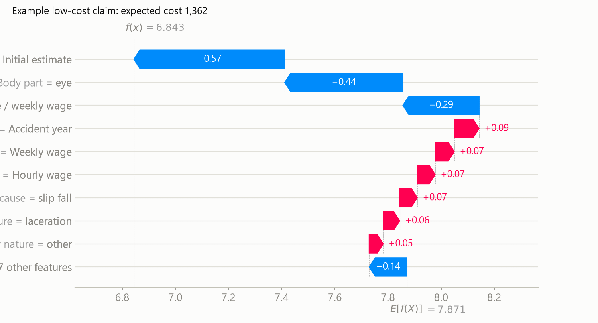
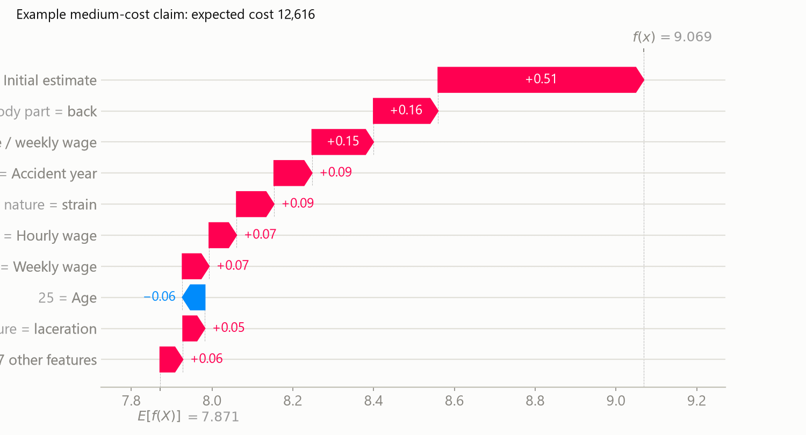
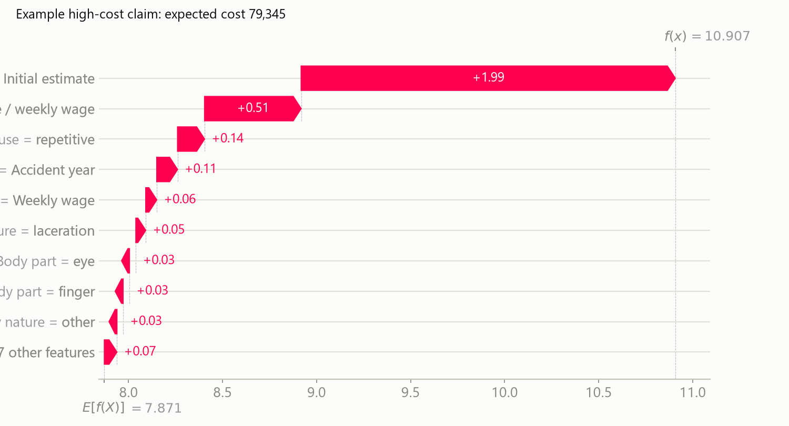

# Explainability and fairness

_Generated by `python -m src.pipeline --stage explain`. Do not edit by hand._

The final cost model (LightGBM, tuned (A, Keyword rules)) predicts **A: log cost**. SHAP values are on that log scale: +0.69 means an input roughly doubles the predicted cost (x2), -0.69 halves it, holding everything else fixed. Explained: a seeded random sample of 2,000 test claims. SHAP describes what the model relies on, not what causes costs.

## Business insights

1. **What drives predictions most.** Initial estimate (42% of total attribution), Initial estimate / weekly wage (12% of total attribution), Injury nature (10% of total attribution) are the three strongest drivers. Together the top five account for 77%.
2. **The claim description matters.** Features derived from the free text (Injury nature, Body part, Injury cause, Description length) carry 22% of all attribution: a smaller but real part of what the model knows comes from the description alone.
3. **The adjuster's estimate is informative but not taken at face value.** Moving from the lowest tenth of initial estimates (<= 1,000) to the highest (>= 40,510) changes the model output by x13.84 on average, while the estimates themselves differ 40.5-fold: the model shrinks extreme estimates towards what similar claims usually cost.
4. **Reporting delay has little systematic effect** in the model (x1.00 from fastest to slowest tenth).
5. **Injury type shifts costs strongly.** Relative to the average claim, the injury nature alone moves predictions by x1.75 for soft tissue claims and x0.75 for foreign body claims.
6. **Age matters, but less than the type of injury.** The oldest tenth of claimants (>= 53) gets x1.13 the attribution of the youngest (<= 20): older workers' claims cost more, consistent with longer recovery.

## Global importance

**Takeaway.** Initial estimate is the single most important input (42% of total attribution), followed by Initial estimate / weekly wage (12%). One-hot columns are summed into their source feature so each bar is one business concept.

**Takeaway.** Each dot is one claim; position shows how much that input moved its prediction and colour shows the input's value (red high, blue low), so the direction of each effect can be read off.

## How the top numeric inputs act

**Takeaway.** Grey dots are claims, the blue line is the average SHAP value along the input. Where the line is above zero the input pushes predictions up.

## Three example claims

| Example   | Description                               | Actual cost   | Expected cost   | 80% interval     | Top drivers                                                                      |
|:----------|:------------------------------------------|:--------------|:----------------|:-----------------|:---------------------------------------------------------------------------------|
| low       | SLIPPED USING LATHE IN EYE CORNEA         | 699           | 1,362           | 659 - 1,192      | Initial estimate x0.57; Body part x0.62; Initial estimate / weekly wage x0.75    |
| medium    | LIFTING BOX STRAIN BACK UPPER BACK STRAIN | 7,515         | 12,616          | 6,556 - 12,737   | Initial estimate x1.66; Body part x1.22; Injury nature x1.17                     |
| high      | REPETITIVE COMPUTER USE RIGHT WRIST       | 36,359        | 79,345          | 24,781 - 132,552 | Initial estimate x7.31; Initial estimate / weekly wage x1.67; Injury cause x1.17 |

**Takeaway.** Starting from the average model output (7.87), the largest push up for this low-cost claim comes from Injury nature (x1.11) and the largest push down from Initial estimate (x0.57). Values are on the log scale of the model target.

**Takeaway.** Starting from the average model output (7.87), the largest push up for this medium-cost claim comes from Initial estimate (x1.66) and the largest push down from Age (x0.95). Values are on the log scale of the model target.

**Takeaway.** Starting from the average model output (7.87), the largest push up for this high-cost claim comes from Initial estimate (x7.31) and the largest push down from Accident month (x1.00). Values are on the log scale of the model target.

## Fairness

Test-set accuracy and flag rates by group. *Flag rate (threshold)* uses the fixed probability threshold; *Flagged at 10% capacity* is the share of the group among the 10% of claims ranked highest. Differences in flag rates are expected where true high-cost rates differ; what matters is whether errors are systematically worse for a group. Groups with fewer than 30 test claims are not shown (for gender, the handful recorded as unknown).

### By gender

| Gender   | Claims   | Mean actual   | Predicted / actual   | RMSLE   | Log bias   | True high-cost rate   | Flag rate (threshold)   | Flagged at 10% capacity   | Recall at capacity   |
|:---------|:---------|:--------------|:---------------------|:--------|:-----------|:----------------------|:------------------------|:--------------------------|:---------------------|
| F        | 2,666    | 25,479        | 1.00                 | 0.580   | -0.086     | 36.0%                 | 24.8%                   | 12.0%                     | 33.3%                |
| M        | 8,134    | 20,181        | 1.06                 | 0.548   | -0.044     | 29.4%                 | 20.0%                   | 9.4%                      | 31.8%                |

The log-scale error differs by 0.031 RMSLE between genders.

### By age band

| Age band   | Claims   | Mean actual   | Predicted / actual   | RMSLE   | Log bias   | True high-cost rate   | Flag rate (threshold)   | Flagged at 10% capacity   | Recall at capacity   |
|:-----------|:---------|:--------------|:---------------------|:--------|:-----------|:----------------------|:------------------------|:--------------------------|:---------------------|
| <20        | 1,006    | 10,939        | 1.09                 | 0.517   | -0.023     | 16.9%                 | 8.5%                    | 3.0%                      | 17.6%                |
| 20-24      | 1,781    | 14,892        | 1.02                 | 0.538   | -0.048     | 21.5%                 | 11.9%                   | 4.8%                      | 22.2%                |
| 25-29      | 1,394    | 16,899        | 1.03                 | 0.565   | -0.058     | 25.8%                 | 14.6%                   | 5.3%                      | 20.6%                |
| 30-34      | 1,398    | 20,471        | 1.07                 | 0.576   | -0.054     | 29.9%                 | 21.1%                   | 9.3%                      | 31.1%                |
| 35-39      | 1,270    | 24,162        | 1.03                 | 0.579   | -0.081     | 35.1%                 | 25.0%                   | 11.7%                     | 33.2%                |
| 40-44      | 1,146    | 25,753        | 1.02                 | 0.564   | -0.080     | 38.2%                 | 27.0%                   | 13.5%                     | 35.4%                |
| 45-49      | 1,017    | 25,884        | 1.18                 | 0.527   | -0.040     | 41.4%                 | 30.6%                   | 15.4%                     | 37.3%                |
| 50-54      | 847      | 34,196        | 0.87                 | 0.590   | -0.070     | 40.0%                 | 29.8%                   | 15.2%                     | 38.1%                |
| 55-59      | 588      | 27,695        | 1.11                 | 0.541   | -0.000     | 38.3%                 | 29.8%                   | 18.2%                     | 47.6%                |
| 60-64      | 272      | 30,611        | 1.15                 | 0.532   | -0.059     | 46.0%                 | 38.6%                   | 19.1%                     | 41.6%                |
| 65+        | 81       | 28,135        | 1.02                 | 0.607   | -0.153     | 35.8%                 | 25.9%                   | 16.0%                     | 44.8%                |

Age is a legitimate predictor of recovery time, but it is also a protected characteristic in employment law, so these age-band results should be monitored in production rather than read as a verdict.

### The model with and without gender

| Model          | CV RMSLE   | Test RMSLE   | Test predicted / actual   | Predicted / actual, M   | Predicted / actual, F   |
|:---------------|:-----------|:-------------|:--------------------------|:------------------------|:------------------------|
| with gender    | 0.5856     | 0.5560       | 1.042                     | 1.054                   | 1.012                   |
| without gender | 0.5850     | 0.5562       | 1.041                     | 1.057                   | 1.001                   |

**Recommendation: exclude Gender.** Removing it changes cross-validated RMSLE by -0.0007, below the 0.002 threshold set in advance for a meaningful difference. A protected characteristic that adds no measurable accuracy only adds legal and reputational risk. Removing it barely changes the per-gender bias (largest gap between predicted and actual cost for either gender: 5.4% with it, 5.7% without). The shipped model excludes Gender (`fairness.exclude_gender` in the config).
