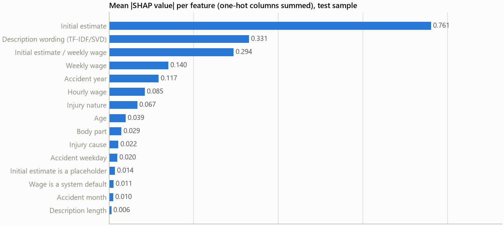
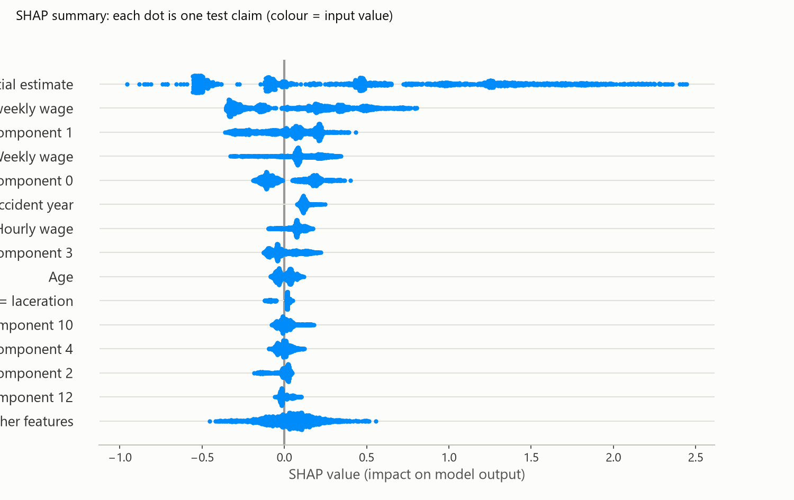
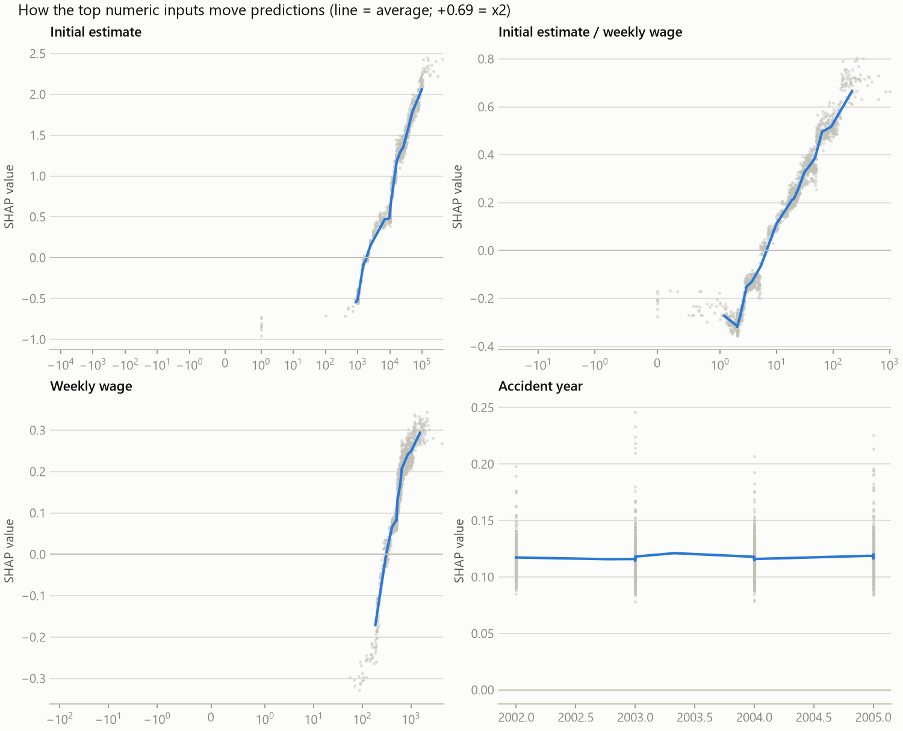

# Explainability and fairness

_Generated by `python -m src.pipeline --stage explain`. Do not edit by hand._

The final cost model (LightGBM, tuned (A, Layers 1-2: + TF-IDF/SVD)) predicts **A: log cost**. SHAP values are on that log scale: +0.69 means an input roughly doubles the predicted cost (x2), -0.69 halves it, holding everything else fixed. Explained: a seeded random sample of 2,000 test claims. SHAP describes what the model relies on, not what causes costs.

## Business insights

1. **What drives predictions most.** Initial estimate (39% of total attribution), Description wording (TF-IDF/SVD) (17% of total attribution), Initial estimate / weekly wage (15% of total attribution) are the three strongest drivers. Together the top five account for 83%.
2. **The claim description matters.** Features derived from the free text (Description wording (TF-IDF/SVD), Injury nature, Body part, Injury cause) carry 23% of all attribution: a smaller but real part of what the model knows comes from the description alone.
3. **The adjuster's estimate is informative but not taken at face value.** Moving from the lowest tenth of initial estimates (<= 1,000) to the highest (>= 40,510) changes the model output by x11.47 on average, while the estimates themselves differ 40.5-fold: the model shrinks extreme estimates towards what similar claims usually cost.
4. **Reporting delay has little systematic effect** in the model (x0.99 from fastest to slowest tenth).
5. **Injury type shifts costs moderately.** Relative to the average claim, the injury nature alone moves predictions by x1.21 for soft tissue claims and x0.82 for burn claims.
6. **Age matters, but less than the type of injury.** The oldest tenth of claimants (>= 53) gets x1.13 the attribution of the youngest (<= 20): older workers' claims cost more, consistent with longer recovery.

## Global importance

**Takeaway.** Initial estimate is the single most important input (39% of total attribution), followed by Description wording (TF-IDF/SVD) (17%). One-hot columns are summed into their source feature so each bar is one business concept.

**Takeaway.** Each dot is one claim; position shows how much that input moved its prediction and colour shows the input's value (red high, blue low), so the direction of each effect can be read off.

## How the top numeric inputs act

**Takeaway.** Grey dots are claims, the blue line is the average SHAP value along the input. Where the line is above zero the input pushes predictions up.

## Three example claims

| Example   | Description                                          | Actual cost   | Expected cost   | 80% interval     | Top drivers                                                                                          |
|:----------|:-----------------------------------------------------|:--------------|:----------------|:-----------------|:-----------------------------------------------------------------------------------------------------|
| low       | HAND SCRAPED AGAINST GRINDER ABRASION LEFT HAND      | 1,607         | 1,368           | 605 - 1,433      | Initial estimate x0.59; Initial estimate / weekly wage x0.72; Description wording (TF-IDF/SVD) x0.72 |
| medium    | MAKING BEDS TWISTED KNEE RIGHT KNEE                  | 7,602         | 12,463          | 4,914 - 13,186   | Initial estimate x1.57; Weekly wage x1.23; Description wording (TF-IDF/SVD) x1.17                    |
| high      | STRUCK PALLET LEFT SHOULDER LEFT STRAIN LEFT FOREARM | 42,344        | 80,095          | 29,284 - 112,860 | Initial estimate x6.26; Initial estimate / weekly wage x1.44; Weekly wage x1.35                      |

**Takeaway.** Starting from the average model output (7.87), the largest push up for this low-cost claim comes from Accident year (x1.12) and the largest push down from Initial estimate (x0.59). Values are on the log scale of the model target.

**Takeaway.** Starting from the average model output (7.87), the largest push up for this medium-cost claim comes from Initial estimate (x1.57) and the largest push down from Age (x0.95). Values are on the log scale of the model target.

**Takeaway.** Starting from the average model output (7.87), the largest push up for this high-cost claim comes from Initial estimate (x6.26) and the largest push down from Injury cause (x0.96). Values are on the log scale of the model target.

## Fairness

Test-set accuracy and flag rates by group. *Flag rate (threshold)* uses the fixed probability threshold; *Flagged at 10% capacity* is the share of the group among the 10% of claims ranked highest. Differences in flag rates are expected where true high-cost rates differ; what matters is whether errors are systematically worse for a group. Groups with fewer than 30 test claims are not shown (for gender, the handful recorded as unknown).

### By gender

| Gender   | Claims   | Mean actual   | Predicted / actual   | RMSLE   | Log bias   | True high-cost rate   | Flag rate (threshold)   | Flagged at 10% capacity   | Recall at capacity   |
|:---------|:---------|:--------------|:---------------------|:--------|:-----------|:----------------------|:------------------------|:--------------------------|:---------------------|
| F        | 2,666    | 25,479        | 1.00                 | 0.571   | -0.064     | 36.0%                 | 24.4%                   | 11.9%                     | 33.2%                |
| M        | 8,134    | 20,181        | 1.06                 | 0.541   | -0.033     | 29.4%                 | 20.0%                   | 9.4%                      | 31.8%                |

The log-scale error differs by 0.031 RMSLE between genders.

### By age band

| Age band   | Claims   | Mean actual   | Predicted / actual   | RMSLE   | Log bias   | True high-cost rate   | Flag rate (threshold)   | Flagged at 10% capacity   | Recall at capacity   |
|:-----------|:---------|:--------------|:---------------------|:--------|:-----------|:----------------------|:------------------------|:--------------------------|:---------------------|
| <20        | 1,006    | 10,939        | 1.08                 | 0.506   | -0.018     | 16.9%                 | 8.6%                    | 2.8%                      | 16.5%                |
| 20-24      | 1,781    | 14,892        | 1.02                 | 0.527   | -0.023     | 21.5%                 | 11.8%                   | 4.6%                      | 21.4%                |
| 25-29      | 1,394    | 16,899        | 1.04                 | 0.558   | -0.032     | 25.8%                 | 14.5%                   | 5.5%                      | 21.4%                |
| 30-34      | 1,398    | 20,471        | 1.06                 | 0.567   | -0.046     | 29.9%                 | 21.2%                   | 9.7%                      | 32.3%                |
| 35-39      | 1,270    | 24,162        | 1.03                 | 0.571   | -0.071     | 35.1%                 | 24.8%                   | 12.0%                     | 34.1%                |
| 40-44      | 1,146    | 25,753        | 1.02                 | 0.563   | -0.067     | 38.2%                 | 26.9%                   | 13.4%                     | 35.2%                |
| 45-49      | 1,017    | 25,884        | 1.18                 | 0.518   | -0.024     | 41.4%                 | 30.3%                   | 15.5%                     | 37.5%                |
| 50-54      | 847      | 34,196        | 0.88                 | 0.586   | -0.052     | 40.0%                 | 29.9%                   | 15.0%                     | 37.5%                |
| 55-59      | 588      | 27,695        | 1.10                 | 0.535   | -0.002     | 38.3%                 | 30.1%                   | 18.0%                     | 47.1%                |
| 60-64      | 272      | 30,611        | 1.10                 | 0.534   | -0.084     | 46.0%                 | 37.9%                   | 17.6%                     | 38.4%                |
| 65+        | 81       | 28,135        | 0.97                 | 0.569   | -0.167     | 35.8%                 | 24.7%                   | 16.0%                     | 44.8%                |

Age is a legitimate predictor of recovery time, but it is also a protected characteristic in employment law, so these age-band results should be monitored in production rather than read as a verdict.

### The model with and without gender

| Model          | CV RMSLE   | Test RMSLE   | Test predicted / actual   | Predicted / actual, M   | Predicted / actual, F   |
|:---------------|:-----------|:-------------|:--------------------------|:------------------------|:------------------------|
| with gender    | 0.5706     | 0.5488       | 1.036                     | 1.047                   | 1.007                   |
| without gender | 0.5702     | 0.5485       | 1.042                     | 1.057                   | 1.005                   |

**Recommendation: exclude Gender.** Removing it changes cross-validated RMSLE by -0.0004, below the 0.002 threshold set in advance for a meaningful difference. A protected characteristic that adds no measurable accuracy only adds legal and reputational risk. Removing it barely changes the per-gender bias (largest gap between predicted and actual cost for either gender: 4.7% with it, 5.7% without). The shipped model excludes Gender (`fairness.exclude_gender` in the config).
