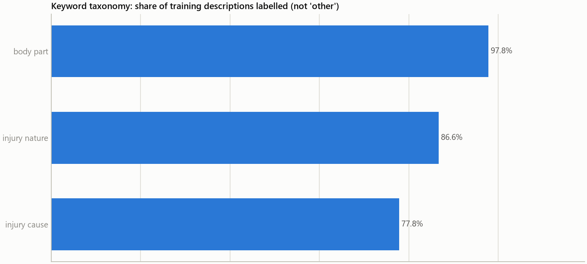

# Features

_Generated by `python -m src.pipeline --stage features`. Do not edit by hand._

All statistics use the 43,200 training claims (accidents before 29 May 2002).

## 1. Feature catalogue

Every model input, grouped by how the pipeline preprocesses it. Statistics are on training claims before imputation. The target and anything derived from it are never inputs.

| Feature                    | Branch          | Definition                                                              | Why                                                                                                                          | Missing before imputation   | Share = 1 (flags)   |
|:---------------------------|:----------------|:------------------------------------------------------------------------|:-----------------------------------------------------------------------------------------------------------------------------|:----------------------------|:--------------------|
| age                        | numeric         | Claimant age at the accident.                                           | Recovery tends to take longer with age; EDA section 4 shows the pattern here.                                                | 0.0%                        |                     |
| dependent_children         | numeric         | Number of dependent children.                                           | Dependants can raise benefits.                                                                                               | 0.0%                        |                     |
| dependents_other           | numeric         | Number of other dependants.                                             | As above; recorded separately.                                                                                               | 0.0%                        |                     |
| total_dependents           | numeric         | Children plus other dependants.                                         | One measure of family obligations; the raw counts are sparse.                                                                | 0.0%                        |                     |
| hours_per_week             | numeric         | Weekly hours (invalid values imputed).                                  | Exposure to risk and the base for wage replacement.                                                                          | 0.1%                        |                     |
| days_per_week              | numeric         | Days worked per week (invalid values imputed).                          | Shift pattern.                                                                                                               | <0.1%                       |                     |
| hours_per_day              | numeric         | Hours per week / days per week.                                         | Long shifts are linked with fatigue.                                                                                         | 0.2%                        |                     |
| accident_year              | numeric         | Calendar year of the accident.                                          | Carries the cost trend. Trees cannot extrapolate beyond the last training year; Phase 5 tests explicit ways to handle drift. | 0.0%                        |                     |
| accident_hour              | numeric         | Hour of the accident (0-23).                                            | Time of day relates to shift type and fatigue.                                                                               | 0.0%                        |                     |
| log_weekly_wages           | numeric         | log(1 + weekly wage).                                                   | Wage replacement scales with pay; the log tames the long right tail.                                                         | 1.0%                        |                     |
| log_initial_estimate       | numeric         | log(1 + adjuster's initial estimate).                                   | The adjuster's view of severity, recorded at current prices (EDA sections 1 and 5).                                          | 0.0%                        |                     |
| report_delay_days          | log numeric     | Days from accident to report (log-transformed in the model).            | Reporting delay is a known cost driver; EDA section 3 shows the pattern here.                                                | 0.0%                        |                     |
| hourly_wage                | log numeric     | Weekly wage / hours, hours clipped up to 1 (log-transformed).           | Pay rate independent of hours; clipping avoids dividing by near-zero hours.                                                  | 1.1%                        |                     |
| initial_to_wage_ratio      | log numeric     | Initial estimate / weekly wage (log-transformed).                       | Roughly how many weeks of pay the adjuster reserved, i.e. expected time off work.                                            | 1.0%                        |                     |
| is_weekend                 | binary          | Accident on a Saturday or Sunday.                                       | Weekend work often means different staffing and tasks.                                                                       | 0.0%                        | 10.5%               |
| is_night_shift             | binary          | Accident after 20:00 or before 06:00, excluding times of exactly 00:00. | Night work is linked with fatigue. 00:00 is excluded because it mostly means 'time unknown'.                                 | 0.0%                        | 3.8%                |
| accident_time_unknown      | binary          | Accident time recorded as exactly 00:00.                                | A recording artifact concentrated in recent years (data quality report).                                                     | 0.0%                        | 0.6%                |
| is_part_time               | binary          | Claimant is part-time.                                                  | Part-time workers differ in hours, pay and job type.                                                                         | 0.0%                        | 8.3%                |
| wage_is_default            | binary          | Weekly wage equals a suspected system default (200, 500).               | These values track recording eras, not pay (data quality report).                                                            | 0.0%                        | 30.3%               |
| initial_is_default         | binary          | Initial estimate equals a placeholder value (500).                      | These estimates are less accurate than others (evidence in section 2).                                                       | 0.0%                        | 14.5%               |
| initial_is_nominal         | binary          | Initial estimate of 1 or less.                                          | A nominal placeholder rather than an estimate.                                                                               | 0.0%                        | <0.1%               |
| weekly_wages_was_missing   | binary          | Weekly wage was missing or invalid and has been imputed.                | Lets the model treat imputed values differently.                                                                             | 0.0%                        | 1.0%                |
| hours_per_week_was_missing | binary          | Hours were missing or invalid and have been imputed.                    | As above.                                                                                                                    | 0.0%                        | 0.1%                |
| days_per_week_was_missing  | binary          | Days were invalid and have been imputed.                                | As above.                                                                                                                    | 0.0%                        | <0.1%               |
| gender                     | categorical     | Recorded gender (M, F, U).                                              | Kept for now; Phase 7 compares the model with and without it.                                                                | 0.0%                        |                     |
| marital_status             | categorical     | M, S or U; unknown kept as its own category.                            | Unknown can itself carry signal.                                                                                             | 0.0%                        |                     |
| age_band                   | categorical     | Age in bands (edges in config).                                         | Lets linear models capture a non-linear age effect.                                                                          | 0.0%                        |                     |
| accident_month             | categorical     | Month of the accident.                                                  | Seasonal patterns, e.g. outdoor work.                                                                                        | 0.0%                        |                     |
| accident_weekday           | categorical     | Day of the week of the accident.                                        | Staffing and task mix vary by day.                                                                                           | 0.0%                        |                     |
| body_part                  | text rules (L1) | Keyword taxonomy: injured body part, 'multiple' if several areas.       | Cost varies widely by body part (EDA section 2).                                                                             | 0.0%                        |                     |
| injury_nature              | text rules (L1) | Keyword taxonomy: nature of injury, most severe mention wins.           | Cost varies widely by nature of injury (EDA section 2).                                                                      | 0.0%                        |                     |
| injury_cause               | text rules (L1) | Keyword taxonomy: how the injury happened.                              | Mechanism relates to severity (falls, vehicles, lifting).                                                                    | 0.0%                        |                     |
| num_body_parts_mentioned   | text rules (L1) | Distinct body parts mentioned (after the finger/hand rule).             | More injured areas usually means more treatment.                                                                             | 0.0%                        |                     |
| description_length         | text rules (L1) | Characters in the description.                                          | Longer descriptions can signal more complex injuries.                                                                        | 0.0%                        |                     |

## 2. Which initial estimates behave like placeholders?

Adjusters often enter round numbers (EDA section 1), so a natural idea is to flag round estimates as unreliable. The table tests that on training claims: a flag is only useful if flagged estimates are further from the final cost (higher error).

| Definition            | Share of claims   |   Median abs log error, flagged |   Median abs log error, others |
|:----------------------|:------------------|--------------------------------:|-------------------------------:|
| Multiple of 500       | 62.5%             |                           0.407 |                          0.433 |
| Multiple of 1,000     | 29.6%             |                           0.383 |                          0.433 |
| Equal to 500 (chosen) | 14.5%             |                           0.494 |                          0.404 |

Round numbers in general are *not* less accurate, so a 'round number' flag would add noise. Only the most common single value is clearly worse than the rest, so the `initial_is_default` flag covers exactly the configured value(s).

## 3. Keyword taxonomy

Rules in `src/features/text_rules.py`; keyword lists in `config/config.yaml`. Keywords match whole words. For nature and cause the categories are in priority order, so a description mentioning both a laceration and a fracture is labelled a fracture. A finger mentioned together with its hand counts as a finger, so *multiple* means separate areas of the body.

The dictionaries started from the categories in the project brief and were extended by reading unmatched descriptions: foreign body, hernia, inflammation, infection, soft tissue, psychological, bite/sting, dermatitis, amputation and pain were added to nature; vehicle, assault, bending/twisting, tool use, exposure and animal/insect to cause; trunk to body part. Descriptions that name an injury but not how it happened (for example 'STRAIN LOWER BACK') legitimately stay *other* for cause.

**Coverage on training claims**

**Takeaway.** The rules label 98% of descriptions for body part but only 78% for injury cause; the rest stay *other*. Cause is the hardest field because many descriptions name the injury but not how it happened, which no keyword list can fix.

| Field         | Labelled (not 'other')   |
|:--------------|:-------------------------|
| body_part     | 97.8%                    |
| injury_nature | 86.6%                    |
| injury_cause  | 77.8%                    |

### Body part

| body_part   |   Claims | Share of claims   |   Median cost |
|:------------|---------:|:------------------|--------------:|
| multiple    |    10123 | 23.4%             |         2,845 |
| back        |     8213 | 19.0%             |         6,578 |
| finger      |     6544 | 15.1%             |           700 |
| eye         |     3254 | 7.5%              |           396 |
| hand        |     2375 | 5.5%              |         1,026 |
| shoulder    |     1910 | 4.4%              |         5,503 |
| arm         |     1841 | 4.3%              |         2,210 |
| knee        |     1807 | 4.2%              |         4,241 |
| foot        |     1274 | 2.9%              |         2,003 |
| ankle       |     1125 | 2.6%              |         2,276 |
| wrist       |     1105 | 2.6%              |         3,007 |
| other       |      964 | 2.2%              |         3,613 |
| head        |      773 | 1.8%              |         1,673 |
| leg         |      755 | 1.7%              |         1,527 |
| neck        |      646 | 1.5%              |         4,918 |
| trunk       |      491 | 1.1%              |         4,421 |

Sample of descriptions still labelled *other*:

- `JAMMED BETWEEN AND MOVING DOORS STRAINED UPPER LOWER LIMBS`
- `FELL DOWN STEPS STRAINED LIGAMENT`
- `SHIFTER FELL FROM PIPES`
- `PENCIL GRINDER LACERATION LEFT LEFT`
- `WORK RELATED STRESS STRESS`
- `STRUCK KNIFE LACERATION RIGHT MIDDLE RING LACERATION`
- `SLIPPED ON WET FLOOR PAIN AND ANXIETY`
- `LIFTING TIMBER EPICONDYLITIS`
- `AND STRESS IN WORK PLACE POST TRAUMATIC KERATITIS`
- `WHILE LIFTING PATIENT`

### Injury nature

| injury_nature   |   Claims | Share of claims   |   Median cost |
|:----------------|---------:|:------------------|--------------:|
| strain          |    11675 | 27.0%             |         6,010 |
| laceration      |     9054 | 21.0%             |           694 |
| other           |     5772 | 13.4%             |         3,867 |
| contusion       |     2547 | 5.9%              |         1,304 |
| foreign body    |     2462 | 5.7%              |           364 |
| fracture        |     2405 | 5.6%              |         3,486 |
| sprain          |     2155 | 5.0%              |         3,049 |
| burn            |     1298 | 3.0%              |           707 |
| inflammation    |     1076 | 2.5%              |         3,739 |
| soft tissue     |     1045 | 2.4%              |         5,411 |
| pain            |     1013 | 2.3%              |         6,457 |
| crush           |      865 | 2.0%              |         2,215 |
| puncture        |      857 | 2.0%              |         1,231 |
| infection       |      261 | 0.6%              |         1,449 |
| hernia          |      186 | 0.4%              |        10,492 |
| bite sting      |      181 | 0.4%              |         1,509 |
| psychological   |      145 | 0.3%              |        18,745 |
| dermatitis      |      119 | 0.3%              |         2,048 |
| amputation      |       84 | 0.2%              |         2,771 |

Sample of descriptions still labelled *other*:

- `MELTED PLASTIC FELL ONTO HAND LEFT MIDDLE FINGER`
- `HIT WITH HAMMER CHISEL METAL LODGED IN ARM`
- `LIFTING DROP DOOR NECK RIGHT SIDE RIGHT SHOULDER`
- `MOVING CRATES AND FELL OFF DOCK ANKLE KNEE INJURY`
- `STEPPED AND TWISTED TO RIGHT ARM`
- `TRIP AND FALL LEFT AND RIGHT HAND`
- `LOWER BACK INJURY`
- `FELL OFF LADDER LEFT HAND`
- `FELL OFF MOTOR BIKE MULTIPLE INJURIES`
- `STAPLE EMBEDDED IN FINGER`

### Injury cause

| injury_cause     |   Claims | Share of claims   |   Median cost |
|:-----------------|---------:|:------------------|--------------:|
| other            |     9590 | 22.2%             |         2,472 |
| slip fall        |     9335 | 21.6%             |         3,195 |
| lifting          |     7440 | 17.2%             |         6,233 |
| struck by        |     6813 | 15.8%             |           827 |
| tool use         |     3157 | 7.3%              |           641 |
| caught in        |     2236 | 5.2%              |         1,770 |
| bending twisting |     1341 | 3.1%              |         5,158 |
| exposure         |     1027 | 2.4%              |           689 |
| vehicle          |      870 | 2.0%              |         5,716 |
| repetitive       |      845 | 2.0%              |         6,988 |
| animal insect    |      432 | 1.0%              |         2,119 |
| assault          |      114 | 0.3%              |         2,967 |

Sample of descriptions still labelled *other*:

- `EXPLOSION HIGH PRESSURE SPRAY GUN PUNCTURE WOUND RIGHT FOOT`
- `REDRESSING RESIDENT STRAIN LEFT ANKLE STRAIN LEFT SHOULDER`
- `SPRAINED LEFT ANKLE SPRAINED RIGHT ANKLE FOOT`
- `FROM TRUCK TO SOFT SAND SOFT TISSUE ARM ELBOW`
- `STEPPED OFF LADDER LOWER BACK STRAIN`
- `GRADUAL ONSET STRAIN LEFT SHOULDER AND HEAD`
- `FOREIGN BODY FOREIGN OBJECT FOREIGN BODY LEFT EYE`
- `STRAINED LOWER BACK STRAINED RIGHT HAND`
- `GETTING OUT FROM TRUCK CAB SPRAINED LEFT ANKLE AND LEG`
- `WHILE DEALING CARDS RIGHT TENDON SYNOVITIS RIGHT WRIST`

## 4. Model matrix

With the keyword-rule features switched on, the fitted pipeline turns each claim into **109 columns**:

| Branch            |   Columns |
|:------------------|----------:|
| rules_categorical |        47 |
| categorical       |        36 |
| numeric           |        11 |
| binary            |        10 |
| log               |         3 |
| rules_numeric     |         2 |

The `text_layers.rules` switch removes the keyword-rule columns for the Phase 5 ablation. The target (`UltimateIncurredClaimCost`) is not among the 34 input columns the pipeline reads, a check that also runs in the test suite.

## 5. Leakage safeguards

- **Nothing learned outside the pipeline.** Group medians, scalers and one-hot categories are all steps of one scikit-learn Pipeline. They are fit on training rows only, and cross-validation refits them in every fold.
- **Fixed rules only before the split.** Cleaning, feature formulas and the keyword taxonomy use thresholds fixed in the config and learn nothing from the data.
- **Design decisions on training claims only.** The placeholder-estimate value and the keyword-list iterations both used training claims.
- **No target in the inputs.** The target and anything derived from it (such as the ultimate/initial ratio) are never model inputs.
