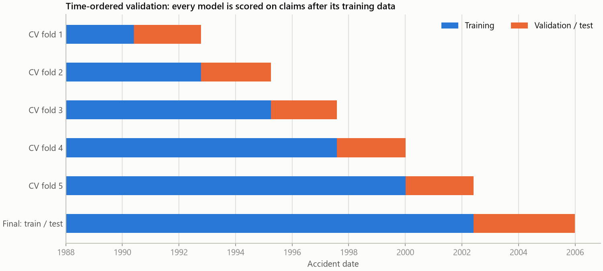
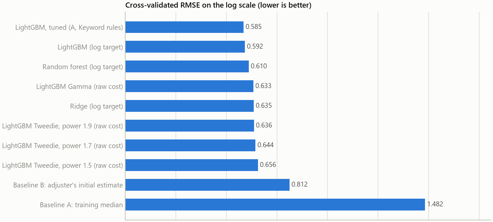
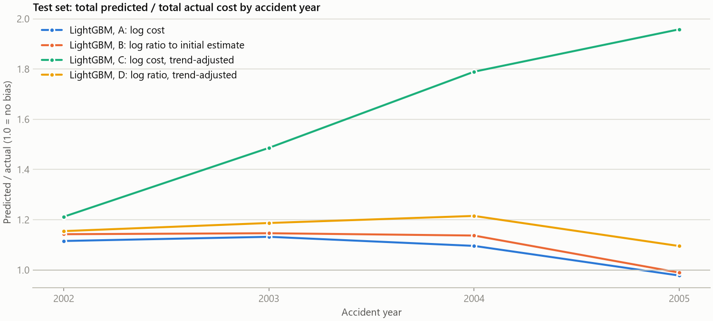
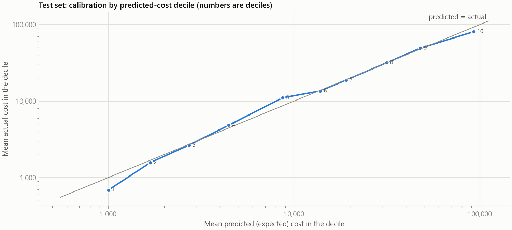
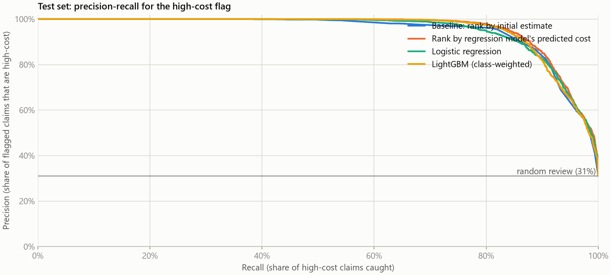

# Results

_Generated by `python -m src.pipeline --stage report`. Do not edit by hand._

## 1. Validation design

- **Final test set:** the most recent 10,800 claims (accidents from 2002-05-29 to 2005-12-31). It is scored once, after every choice has been made.
- **Training period:** 43,200 claims from 1988-01-01 to 2002-05-29.
- **Model selection:** 5 time-ordered folds inside the training period. Each fold trains on everything before a block of claims and validates on that block, so a model is always scored on claims that happened after its training data, as in deployment. A random K-fold split would mix future claims into training and, with costs rising this fast, would flatter every model.
- **Out-of-time calibration:** the high-cost probabilities and the review threshold are calibrated on the most recent 20% of the training period, with the model fit on the earlier part.

|   Fold | Trains on                | Training claims   | Validates on             | Validation claims   | Validation median cost   |
|-------:|:-------------------------|:------------------|:-------------------------|:--------------------|:-------------------------|
|      1 | 1988-01-01 to 1990-05-28 | 7,199             | 1990-05-28 to 1992-10-13 | 7,201               | 2,423                    |
|      2 | 1988-01-01 to 1992-10-13 | 14,400            | 1992-10-13 to 1995-04-02 | 7,200               | 2,910                    |
|      3 | 1988-01-01 to 1995-04-02 | 21,600            | 1995-04-02 to 1997-07-31 | 7,199               | 1,944                    |
|      4 | 1988-01-01 to 1997-07-31 | 28,799            | 1997-07-31 to 2000-01-06 | 7,201               | 3,168                    |
|      5 | 1988-01-01 to 2000-01-06 | 36,000            | 2000-01-07 to 2002-05-29 | 7,200               | 5,585                    |

**The test period is much more expensive than the training period.** Its median cost is 7,640 against 2,819 in training (2.7x), and 31.0% of test claims exceed the training high-cost threshold of 16,406 (10% by construction in training). Every test result below should be read against that shift.

## 2. Model comparison

All models share one preprocessing pipeline. *CV* columns are the mean (± standard deviation) over the time-ordered folds and drive every decision; *Test* columns are the single final evaluation. RMSLE is RMSE on the log scale, so it measures relative error and treats small and large claims evenly. **RMSE in currency is dominated by the largest claims**: one claim missed by a million outweighs thousands of small ones, so it is shown for completeness but not used to choose. Currency metrics use the expected (mean) prediction; log metrics use the typical (median-type) prediction.

| Model                                   | CV RMSLE        | CV log bias   | Test RMSLE   | Test R² (log)   | Test MAE   | Test MAE (typical)   | Test RMSE   | Test total pred / actual   |
|:----------------------------------------|:----------------|:--------------|:-------------|:----------------|:-----------|:---------------------|:------------|:---------------------------|
| Baseline A: training median             | 1.4823 ± 0.1614 | -0.106        | 1.7928       | -0.328          | 19,657     | 19,657               | 59,836      | 0.131                      |
| Baseline B: adjuster's initial estimate | 0.8122 ± 0.0587 | -0.197        | 0.8882       | 0.674           | 11,641     | 11,641               | 56,208      | 0.732                      |
| Ridge (log target)                      | 0.6353 ± 0.0164 | -0.037        | 0.6300       | 0.836           | 13,309     | 10,969               | 52,539      | 0.992                      |
| Random forest (log target)              | 0.6105 ± 0.0241 | -0.009        | 0.5896       | 0.856           | 12,688     | 10,402               | 50,757      | 0.961                      |
| LightGBM (log target)                   | 0.5916 ± 0.0281 | -0.016        | 0.5596       | 0.871           | 13,640     | 10,467               | 51,112      | 1.065                      |
| LightGBM Tweedie, power 1.5 (raw cost)  | 0.6558 ± 0.0299 | +0.134        | 0.6154       | 0.843           | 12,033     | 12,033               | 51,364      | 0.876                      |
| LightGBM Tweedie, power 1.7 (raw cost)  | 0.6438 ± 0.0278 | +0.116        | 0.6060       | 0.848           | 11,900     | 11,900               | 51,212      | 0.871                      |
| LightGBM Tweedie, power 1.9 (raw cost)  | 0.6361 ± 0.0288 | +0.109        | 0.5930       | 0.855           | 11,680     | 11,680               | 51,070      | 0.853                      |
| LightGBM Gamma (raw cost)               | 0.6334 ± 0.0262 | +0.100        | 0.5958       | 0.853           | 11,762     | 11,762               | 51,066      | 0.865                      |

**Takeaway.** LightGBM (log target) is the best model family in cross-validation (RMSLE 0.5916), 27% lower than using the adjuster's initial estimate (0.8122); on the test set the gap is 37%. The best raw-cost loss is LightGBM Gamma (raw cost) (CV RMSLE 0.6334). These losses predict the mean directly, which sits above the median on the log scale, so RMSLE understates them a little; their test currency metrics are the fairer comparison.

## 3. Handling the rise in costs over time

EDA showed the median claim cost growing 3.7x across the period, mainly as a price-level change. Four ways of handling that were compared with the best model family: **A** predicts log cost directly; **B** predicts the log ratio of ultimate cost to the adjuster's initial estimate, which is recorded at current prices; **C** removes a log-linear cost trend fitted on the last training years and adds it back when predicting, so costs keep rising after the training period; **D** combines B and C. Log bias below 0 means the model predicts too low.

| Approach                                   | CV RMSLE   | CV log bias   | Test RMSLE   | Test log bias   | Test total pred / actual   |
|:-------------------------------------------|:-----------|:--------------|:-------------|:----------------|:---------------------------|
| LightGBM, A: log cost                      | 0.5916     | -0.016        | 0.5596       | -0.050          | 1.065                      |
| LightGBM, B: log ratio to initial estimate | 0.5955     | -0.017        | 0.6298       | -0.068          | 1.088                      |
| LightGBM, C: log cost, trend-adjusted      | 0.6124     | -0.015        | 0.6662       | +0.333          | 1.707                      |
| LightGBM, D: log ratio, trend-adjusted     | 0.6029     | -0.056        | 0.6263       | -0.015          | 1.159                      |

**Takeaway.** Cross-validation chooses **LightGBM, A: log cost** (CV RMSLE 0.5916). The test set agrees: it is also the best approach there. In the last test year (2005) total predicted over total actual cost is A 0.98, B 0.99, C 1.96, D 1.10.

## 4. What the text features add (ablation)

The chosen model and drift approach, refit with and without the keyword-rule features of the description (body part, injury nature, injury cause). Structured fields (including the initial estimate) are always present, so this measures what the free-text description adds on top of them.

| Feature set      | CV RMSLE   | Test RMSLE   | Test R² (log)   |
|:-----------------|:-----------|:-------------|:----------------|
| No text features | 0.7268     | 0.6925       | 0.802           |
| Keyword rules    | 0.5916     | 0.5596       | 0.871           |

**Takeaway.** Adding the keyword-rule features to the structured fields changes CV RMSLE by -18.6% and test RMSLE by -19.2%. The final model uses **Keyword rules**: the text features are only kept when they improve CV RMSLE by more than the configured tolerance.

## 5. Hyperparameter tuning

Optuna (seeded TPE sampler, 25 trials) searched the model settings, scoring each trial by the same time-ordered cross-validation. The test set played no part. All trials are stored in `reports/metrics/best_params.json`.

| Setting           | Value   |
|:------------------|:--------|
| learning_rate     | 0.02336 |
| n_estimators      | 438     |
| num_leaves        | 52      |
| min_child_samples | 24      |
| colsample_bytree  | 0.5145  |
| subsample         | 0.8512  |
| reg_lambda        | 8.181   |

**Takeaway.** Tuning moves CV RMSLE from 0.5916 to 0.5850 (-1.1%), a modest gain: the defaults were already reasonable.

## 6. Final model on the test set

**LightGBM, tuned (A, Keyword rules)** with 106 input columns. Expected (mean) costs use a smearing factor of 1.454, estimated from out-of-fold residuals within the training period: exponentiating a log-scale prediction gives roughly the median, which is below the mean for skewed costs, and reserves need the mean.

| Metric                                | Final model   | Adjuster estimate   |
|:--------------------------------------|:--------------|:--------------------|
| RMSE, log scale (RMSLE)               | 0.5562        | 0.8882              |
| R², log scale                         | 0.872         | 0.674               |
| MAE, expected (mean) prediction       | 13,321        | 11,641              |
| MAE, typical (median-type) prediction | 10,319        | 11,641              |
| RMSE (currency)                       | 50,875        | 56,208              |
| Total predicted / total actual        | 1.041         | 0.732               |

|   Predicted-cost decile |   Claims | Mean predicted   | Mean actual   | Predicted / actual   |
|------------------------:|---------:|:-----------------|:--------------|:---------------------|
|                       1 |     1080 | 1,005            | 690           | 1.46                 |
|                       2 |     1080 | 1,688            | 1,575         | 1.07                 |
|                       3 |     1080 | 2,726            | 2,663         | 1.02                 |
|                       4 |     1080 | 4,457            | 4,843         | 0.92                 |
|                       5 |     1080 | 8,691            | 11,047        | 0.79                 |
|                       6 |     1080 | 13,864           | 13,588        | 1.02                 |
|                       7 |     1080 | 19,065           | 18,838        | 1.01                 |
|                       8 |     1080 | 31,562           | 31,740        | 0.99                 |
|                       9 |     1080 | 47,860           | 49,188        | 0.97                 |
|                      10 |     1080 | 92,732           | 80,715        | 1.15                 |

**Takeaway.** Ranked from cheapest to dearest predicted claims, mean actual cost rises with every decile, and the predicted/actual ratio runs from 0.79 to 1.46. Overall the model books 1.04 of the true total cost, against 0.73 for the adjusters' initial estimates.

**On MAE.** MAE is lowest when predicting the median, not the mean. The model's typical (median-type) prediction has MAE 10,319; its expected (mean) prediction, which is what reserves need, has MAE 13,321; the adjusters' estimates have 11,641. The adjusters' lower MAE comes from estimating low across the board (they book 0.73 of the true total), which suits the many small claims but leaves the book under-reserved.

**80% prediction interval** (LightGBM quantile models at 10% and 90% on the same target). Test coverage is **80.8%** against the nominal 80%; 6.1% of claims fall below the interval and 13.1% above it. The typical interval spans a factor of 2.7 from low to high. Coverage by accident year: 2002: 78%, 2003: 80%, 2004: 83%, 2005: 81%.

## 7. Error analysis (test set)

### By size of the actual claim

| Actual-cost band   | Claims   | Mean actual   | Mean predicted   | Predicted / actual   | MAE     | RMSLE   |
|:-------------------|:---------|:--------------|:-----------------|:---------------------|:--------|:--------|
| Top 1%             | 108      | 331,543       | 76,371           | 0.23                 | 255,172 | 2.223   |
| Top 1-10%          | 972      | 95,539        | 73,120           | 0.77                 | 49,672  | 1.200   |
| Bottom 90%         | 9,720    | 10,639        | 16,689           | 1.57                 | 6,999   | 0.380   |

**Takeaway.** For the top 1% of claims by actual cost, the model predicts on average 76,371 against an actual 331,543 (ratio 0.23). The very largest claims are under-predicted: much of what makes a claim huge (complications, litigation, long time off work) happens after it is reported. This is why the high-cost flag is judged on ranking and review capacity rather than on exact amounts.

### By injury nature

| Injury nature   | Claims   | Mean actual   | Mean predicted   | Predicted / actual   | MAE    | RMSLE   |
|:----------------|:---------|:--------------|:-----------------|:---------------------|:-------|:--------|
| strain          | 3,412    | 30,705        | 32,433           | 1.06                 | 19,211 | 0.590   |
| laceration      | 2,338    | 7,518         | 8,407            | 1.12                 | 4,372  | 0.450   |
| other           | 1,278    | 26,738        | 27,210           | 1.02                 | 16,620 | 0.603   |
| foreign body    | 617      | 2,793         | 3,558            | 1.27                 | 1,758  | 0.397   |
| fracture        | 616      | 31,780        | 28,146           | 0.89                 | 21,263 | 0.625   |
| contusion       | 463      | 12,323        | 13,291           | 1.08                 | 7,312  | 0.560   |
| sprain          | 447      | 22,273        | 24,768           | 1.11                 | 14,035 | 0.666   |
| soft tissue     | 308      | 23,261        | 17,483           | 0.75                 | 15,368 | 0.676   |
| burn            | 275      | 5,879         | 7,670            | 1.30                 | 4,046  | 0.474   |
| inflammation    | 199      | 33,545        | 33,277           | 0.99                 | 19,130 | 0.637   |
| puncture        | 186      | 11,674        | 12,288           | 1.05                 | 6,554  | 0.488   |
| pain            | 180      | 37,889        | 35,756           | 0.94                 | 20,329 | 0.583   |
| crush           | 153      | 20,173        | 20,001           | 0.99                 | 12,594 | 0.673   |
| psychological   | 102      | 66,286        | 80,391           | 1.21                 | 38,754 | 0.504   |

**Takeaway.** Log-scale error is lowest for foreign body (0.397) and highest for soft tissue (0.676) among natures with enough claims.

### By body part

| Body part   | Claims   | Mean actual   | Mean predicted   | Predicted / actual   | MAE    | RMSLE   |
|:------------|:---------|:--------------|:-----------------|:---------------------|:-------|:--------|
| back        | 1,986    | 32,308        | 32,417           | 1.00                 | 20,638 | 0.591   |
| multiple    | 1,907    | 23,621        | 24,996           | 1.06                 | 14,601 | 0.617   |
| finger      | 1,769    | 8,133         | 8,697            | 1.07                 | 4,737  | 0.454   |
| shoulder    | 815      | 35,903        | 36,204           | 1.01                 | 20,934 | 0.647   |
| eye         | 798      | 3,090         | 4,016            | 1.30                 | 1,526  | 0.379   |
| hand        | 661      | 15,629        | 10,157           | 0.65                 | 11,876 | 0.516   |
| knee        | 573      | 27,132        | 32,454           | 1.20                 | 16,416 | 0.535   |
| arm         | 516      | 18,012        | 18,388           | 1.02                 | 12,057 | 0.587   |
| wrist       | 332      | 24,019        | 26,528           | 1.10                 | 13,550 | 0.613   |
| other       | 265      | 35,086        | 46,065           | 1.31                 | 20,146 | 0.425   |
| ankle       | 263      | 21,324        | 19,359           | 0.91                 | 12,895 | 0.720   |
| foot        | 232      | 20,483        | 21,747           | 1.06                 | 13,933 | 0.573   |
| head        | 230      | 15,462        | 16,368           | 1.06                 | 10,651 | 0.523   |
| leg         | 202      | 15,275        | 16,564           | 1.08                 | 9,342  | 0.583   |
| neck        | 142      | 25,485        | 28,064           | 1.10                 | 15,879 | 0.571   |
| trunk       | 109      | 33,859        | 39,923           | 1.18                 | 16,968 | 0.420   |

### By weekly wage band

| Weekly wage band   | Claims   | Mean actual   | Mean predicted   | Predicted / actual   | MAE    | RMSLE   |
|:-------------------|:---------|:--------------|:-----------------|:---------------------|:-------|:--------|
| <200               | 217      | 17,872        | 18,166           | 1.02                 | 11,275 | 0.595   |
| 200-300            | 525      | 19,657        | 21,229           | 1.08                 | 11,946 | 0.536   |
| 300-400            | 503      | 28,630        | 21,528           | 0.75                 | 20,725 | 0.617   |
| 400-500            | 1,121    | 21,874        | 23,934           | 1.09                 | 13,330 | 0.573   |
| 500-750            | 6,434    | 17,920        | 18,238           | 1.02                 | 11,131 | 0.548   |
| 750-1,000          | 1,183    | 29,307        | 33,519           | 1.14                 | 17,816 | 0.542   |
| 1,000-1,500        | 528      | 41,454        | 46,256           | 1.12                 | 23,927 | 0.566   |
| 1,500+             | 283      | 24,955        | 25,945           | 1.04                 | 15,697 | 0.606   |

### By accident year

| Accident year   | Claims   | Mean actual   | Mean predicted   | Predicted / actual   | MAE    | RMSLE   |
|:----------------|:---------|:--------------|:-----------------|:---------------------|:-------|:--------|
| 2002            | 1,793    | 16,434        | 18,076           | 1.10                 | 10,487 | 0.546   |
| 2003            | 2,978    | 17,764        | 19,723           | 1.11                 | 11,764 | 0.562   |
| 2004            | 3,032    | 22,339        | 23,931           | 1.07                 | 13,921 | 0.547   |
| 2005            | 2,997    | 27,354        | 25,972           | 0.95                 | 15,958 | 0.566   |

## 8. High-cost claim flag (classification)

A claim is **high-cost** if its ultimate cost is at least 16,406, the 90th percentile of training claims. 10.0% of training claims qualify but **31.0% of test claims** do, because costs rose (section 1). Candidates are compared by cross-validated PR-AUC, which focuses on the rare positive class; ROC-AUC is shown for reference.

| Model                                     | CV PR-AUC     | CV ROC-AUC   |
|:------------------------------------------|:--------------|:-------------|
| Baseline: rank by initial estimate        | 0.758 ± 0.105 | 0.911        |
| Rank by regression model's predicted cost | 0.794 ± 0.105 | 0.924        |
| Logistic regression                       | 0.774 ± 0.105 | 0.915        |
| LightGBM (class-weighted)                 | 0.781 ± 0.110 | 0.914        |

**Chosen: Rank by regression model's predicted cost.** Neither dedicated classifier beat ranking claims by the cost model's own predicted cost in cross-validation (it beats Logistic regression in 5 of 5 folds, LightGBM (class-weighted) in 5 of 5 folds). A classifier only sees whether a claim crossed the threshold, while the regression learns from the full cost, so the flag reuses the cost model's prediction and turns it into a probability with a logistic calibration: one model serves both the reserve and the flag.

### Test set, fixed threshold: ranking and review capacity

*Recall, top X%* is the share of all high-cost claims caught when the team reviews only the X% of claims the model ranks highest.

| Model                                     | PR-AUC   | ROC-AUC   | Recall, top 5%   | Recall, top 10%   | Recall, top 20%   | Precision, top 10%   |
|:------------------------------------------|:---------|:----------|:-----------------|:------------------|:------------------|:---------------------|
| Baseline: rank by initial estimate        | 0.943    | 0.965     | 16.1%            | 32.2%             | 63.2%             | 100.0%               |
| Rank by regression model's predicted cost | 0.958    | 0.972     | 16.1%            | 32.2%             | 64.4%             | 100.0%               |
| Logistic regression                       | 0.951    | 0.968     | 16.1%            | 32.2%             | 63.9%             | 100.0%               |
| LightGBM (class-weighted)                 | 0.954    | 0.968     | 16.1%            | 32.2%             | 64.3%             | 100.0%               |

**Takeaway.** Reviewing the top 10% of claims, the chosen flag catches 32.2% of all high-cost claims, against 32.2% when ranking by the adjuster's initial estimate, and 100.0% of the reviewed claims are genuinely high-cost. With 31.0% of test claims high-cost, reviewing 10% can catch at most 32.2% of them, and every method's PR-AUC lies within 0.015 of the others: after the price rise so many claims cross the fixed threshold that almost any ranking finds them. The relative label below is the sharper test.

### Test set, relative label: top 10% of cost within each accident year

Every candidate refit (where it learns) on the relative label. This removes the base-rate shift and asks the real triage question: which claims are unusually severe for their time?

| Model                                     | PR-AUC   | ROC-AUC   | Recall, top 5%   | Recall, top 10%   | Recall, top 20%   | Precision, top 10%   |
|:------------------------------------------|:---------|:----------|:-----------------|:------------------|:------------------|:---------------------|
| Baseline: rank by initial estimate        | 0.567    | 0.888     | 34.1%            | 54.8%             | 72.6%             | 54.9%                |
| Rank by regression model's predicted cost | 0.589    | 0.897     | 35.4%            | 54.9%             | 74.7%             | 55.0%                |
| Logistic regression                       | 0.591    | 0.895     | 35.9%            | 54.6%             | 73.8%             | 54.7%                |
| LightGBM (class-weighted)                 | 0.539    | 0.889     | 34.6%            | 55.1%             | 73.5%             | 55.2%                |

**Takeaway.** On the relative label (base rate 10.0%), reviewing the top 10% of claims catches 54.9% of the relatively severe claims with the chosen flag, against 54.8% when ranking by the adjuster's initial estimate (PR-AUC 0.589 vs 0.567). The gain is marginal: the adjuster's initial estimate already carries most of the signal for *ranking* claims by severity. The model's value is elsewhere: accurate cost levels and totals, an uncertainty range, and drivers.

### Threshold and calibration

The flag threshold is the calibrated probability at which 10% of the latest training claims would be flagged: **0.793**. On the test set it flags 21.2% of claims (precision 99.7%, recall 68.0%). That is more than 10% because more test claims really are expensive; a team with fixed capacity would instead review the top-ranked claims each period, as in the capacity table above.

**Calibration.** Raw scores are turned into probabilities by a logistic calibration fit on the latest training claims (out of time). On the test set the calibrated Brier score is 0.0555, against 0.2141 for always predicting the test base rate. Calibrated probabilities average 31.0% on the test set against an observed high-cost rate of 31.0%, so the calibration carried over to the more expensive test period (the scores rise with the price level through the cost-related inputs).

## Appendix: every model evaluated

One row per distinct model (a configuration that appears in several stages is listed once, under its first name).

| Model                                      | CV RMSLE        | CV log bias   | Test RMSLE   | Test R² (log)   | Test MAE   | Test MAE (typical)   | Test RMSE   | Test total pred / actual   |
|:-------------------------------------------|:----------------|:--------------|:-------------|:----------------|:-----------|:---------------------|:------------|:---------------------------|
| Baseline A: training median                | 1.4823 ± 0.1614 | -0.106        | 1.7928       | -0.328          | 19,657     | 19,657               | 59,836      | 0.131                      |
| Baseline B: adjuster's initial estimate    | 0.8122 ± 0.0587 | -0.197        | 0.8882       | 0.674           | 11,641     | 11,641               | 56,208      | 0.732                      |
| Ridge (log target)                         | 0.6353 ± 0.0164 | -0.037        | 0.6300       | 0.836           | 13,309     | 10,969               | 52,539      | 0.992                      |
| Random forest (log target)                 | 0.6105 ± 0.0241 | -0.009        | 0.5896       | 0.856           | 12,688     | 10,402               | 50,757      | 0.961                      |
| LightGBM (log target)                      | 0.5916 ± 0.0281 | -0.016        | 0.5596       | 0.871           | 13,640     | 10,467               | 51,112      | 1.065                      |
| LightGBM Tweedie, power 1.5 (raw cost)     | 0.6558 ± 0.0299 | +0.134        | 0.6154       | 0.843           | 12,033     | 12,033               | 51,364      | 0.876                      |
| LightGBM Tweedie, power 1.7 (raw cost)     | 0.6438 ± 0.0278 | +0.116        | 0.6060       | 0.848           | 11,900     | 11,900               | 51,212      | 0.871                      |
| LightGBM Tweedie, power 1.9 (raw cost)     | 0.6361 ± 0.0288 | +0.109        | 0.5930       | 0.855           | 11,680     | 11,680               | 51,070      | 0.853                      |
| LightGBM Gamma (raw cost)                  | 0.6334 ± 0.0262 | +0.100        | 0.5958       | 0.853           | 11,762     | 11,762               | 51,066      | 0.865                      |
| LightGBM, B: log ratio to initial estimate | 0.5955 ± 0.0286 | -0.017        | 0.6298       | 0.836           | 14,044     | 10,653               | 54,035      | 1.088                      |
| LightGBM, C: log cost, trend-adjusted      | 0.6124 ± 0.0272 | -0.015        | 0.6662       | 0.817           | 23,692     | 15,163               | 59,950      | 1.707                      |
| LightGBM, D: log ratio, trend-adjusted     | 0.6029 ± 0.0208 | -0.056        | 0.6263       | 0.838           | 15,004     | 10,941               | 55,222      | 1.159                      |
| No text features                           | 0.7268 ± 0.0374 | -0.007        | 0.6925       | 0.802           | 15,882     | 10,934               | 52,146      | 1.196                      |
| LightGBM, tuned (A, Keyword rules)         | 0.5850 ± 0.0240 | -0.012        | 0.5562       | 0.872           | 13,321     | 10,319               | 50,875      | 1.041                      |
